# 01 - Fundamentals, VLANs & Inter-VLAN

> [!abstract] Navigation
> **Index:** [[00 - Cisco CCNA MOC]] | **Next:** [[02 - Remote Access, VTP & Port Security]] | **Commands:** [[CCNA Commands & Troubleshooting#1) Basic CLI & Device Management|CLI]] • [[CCNA Commands & Troubleshooting#3) VLANs, Trunks & VTP|VLANs]]
> **Covers:** PDF Pages 1–24 (OSI Model, IPv4 Subnetting, Basic Cisco IOS CLI, Interface Verification, ARP & MAC Tables, VLANs, 802.1Q Trunking, DTP, Native VLAN, Router-on-a-Stick, DHCP Server, and Multilayer Switch SVI).

---

## 1. The 7 Layers of the OSI Model

The **OSI (Open Systems Interconnection)** model standardizes network communication into seven logical layers, from end-user applications down to physical transmission media.

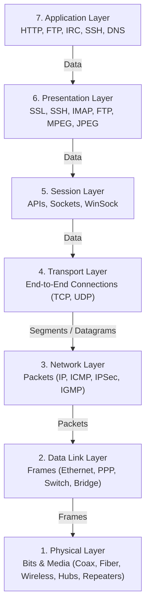

| Layer | Name | Role / PDU | Key Protocols & Components |
| :---: | :--- | :--- | :--- |
| **7** | **Application** | End-User Layer | `HTTP`, `FTP`, `IRC`, `SSH`, `DNS` |
| **6** | **Presentation** | Syntax & Encryption Layer | `SSL`, `SSH`, `IMAP`, `FTP`, `MPEG`, `JPEG` |
| **5** | **Session** | Sync & Send to Port | `APIs`, `Sockets`, `WinSock` |
| **4** | **Transport** | End-to-End Connections | `TCP`, `UDP` |
| **3** | **Network** | ==Packets== & Logical Addressing | `IP`, `ICMP`, `IPSec`, `IGMP` |
| **2** | **Data Link** | ==Frames== & MAC Addressing | `Ethernet`, `PPP`, Switch, Bridge |
| **1** | **Physical** | Physical Structure & Signals | Coax, Fiber, Wireless, Hubs, Repeaters |

^osi-table

---

## 2. Prefix & IPv4 Subnetting

### Private IPv4 Address Ranges (RFC 1918)

| Class | Address Range | Default Mask |
| :---: | :--- | :--- |
| **Class A** | `10.0.0.0` – `10.255.255.255` | `255.0.0.0` (`/8`) |
| **Class B** | `172.16.0.0` – `172.31.255.255` | `255.240.0.0` (`/12`) |
| **Class C** | `192.168.0.0` – `192.168.255.255` | `255.255.0.0` (`/16`) |

> [!warning] Clarification on Source Slide
> The original PDF slide labels these three blocks under "IP Public / Unregistered," but in networking standards (RFC 1918) they are ==Private (non-routable on the public internet) IPv4 ranges==.

### Subnetting Formulas

For any IPv4 prefix `/n` (where $n \in [24, 32]$ for fourth-octet subnetting):

$$
\text{Total IPs} = 2^{(32 - n)}
$$

$$
\text{Usable Hosts} = 2^{(32 - n)} - 2
$$

$$
\text{Last Octet of Subnet Mask} = 256 - \text{Total IPs}
$$

^subnet-formulas

### Example 1: `192.168.0.0/25` (Requirement: 100 PCs)

- **Prefix:** `/25`
- **Host Bits:** $32 - 25 = 7$
- **Total IPs per Subnet:** $2^7 = 128$ (Usable hosts: $128 - 2 = 126 \ge 100\text{ PCs}$)
- **Subnet Mask:** $256 - 128 = 128 \Rightarrow$ ==`255.255.255.128`==

| Subnet # | Network ID | Usable Host Range | Broadcast IP |
| :---: | :--- | :--- | :--- |
| **1** | `192.168.0.0` | `192.168.0.1` – `192.168.0.126` | `192.168.0.127` |
| **2** | `192.168.0.128` | `192.168.0.129` – `192.168.0.254` | `192.168.0.255` |

### Example 2: `10.10.10.0/27` (Requirement: 15 PCs)

- **Prefix:** `/27`
- **Host Bits:** $32 - 27 = 5$
- **Total IPs per Subnet:** $2^5 = 32$ (Usable hosts: $32 - 2 = 30 \ge 15\text{ PCs}$)
- **Subnet Mask:** $256 - 32 = 224 \Rightarrow$ ==`255.255.255.224`==
- **First Subnet Summary:**
  - **IP Network:** `10.10.10.0`
  - **Usable IP Range:** `10.10.10.1` – `10.10.10.30`
  - **IP Broadcast:** `10.10.10.31`

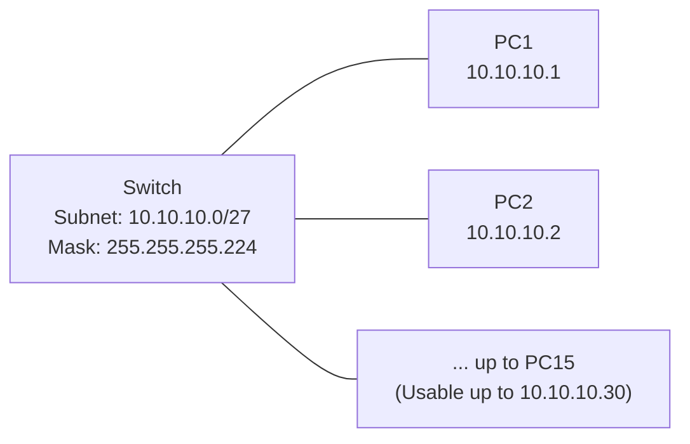

> [!example]- All `/27` Subnets in `10.10.10.0` (Block Size = 32)
>
> | Subnet # | Network IP | Usable Range | Broadcast IP |
> | :---: | :--- | :--- | :--- |
> | 1 | `10.10.10.0` | `10.10.10.1` – `10.10.10.30` | `10.10.10.31` |
> | 2 | `10.10.10.32` | `10.10.10.33` – `10.10.10.62` | `10.10.10.63` |
> | 3 | `10.10.10.64` | `10.10.10.65` – `10.10.10.94` | `10.10.10.95` |
> | 4 | `10.10.10.96` | `10.10.10.97` – `10.10.10.126` | `10.10.10.127` |
> | 5 | `10.10.10.128` | `10.10.10.129` – `10.10.10.158` | `10.10.10.159` |
> | 6 | `10.10.10.160` | `10.10.10.161` – `10.10.10.190` | `10.10.10.191` |
> | 7 | `10.10.10.192` | `10.10.10.193` – `10.10.10.222` | `10.10.10.223` |
> | 8 | `10.10.10.224` | `10.10.10.225` – `10.10.10.254` | `10.10.10.255` |

---

## 3. Basic Cisco IOS CLI & Interface Configuration

### Cisco IOS Mode Transitions

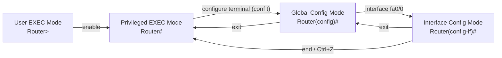

### Configuring a Router Interface

```cisco
Router1# configure terminal
Router1(config)# interface fa0/0
Router1(config-if)# no shutdown
! %LINK-5-CHANGED: Interface FastEthernet0/0, changed state to up
! %LINEPROTO-5-UPDOWN: Line protocol on Interface FastEthernet0/0, changed state to up
Router1(config-if)# ip address 192.168.1.1 255.255.255.0
Router1(config-if)# end
! %SYS-5-CONFIG_I: Configured from console by console
```

### Hostname, Passwords & Saving Configuration

```cisco
Router(config)# hostname R1
R1(config)# enable secret cisco
R1(config)# do write
! Building configuration...
! [OK]
```

> [!tip] Essential Basic Cisco CLI Reference
>
> | Command | Mode | Purpose |
> | :--- | :--- | :--- |
> | `enable` | User EXEC (`>`) | Enter Privileged EXEC mode (`#`) |
> | `configure terminal` (`conf t`) | Privileged (`#`) | Enter Global Configuration mode |
> | `hostname Router1` | Global Config | Change device hostname |
> | `enable password 123` | Global Config | Set plaintext privileged EXEC password |
> | `enable secret cisco` | Global Config | Set ==encrypted== privileged EXEC password (preferred) |
> | `show running-config` | Privileged (`#`) | View active configuration in RAM |
> | `do show running-config` | Any Config Mode | Run a `show` command without exiting config mode |
> | `do write` | Any Config Mode | Save running-config to startup-config (NVRAM) |
> | `exit` / `end` | Any Mode | Step back one level (`exit`) or jump straight to `#` (`end`) |

---

## 4. Verifying Interfaces (`show` Commands)

### Detailed Interface Inspection (`show interface`)

```cisco
Switch# show interface
FastEthernet0/1 is down, line protocol is down (disabled)
  Hardware is Lance, address is 000a.f3d7.ab01 (bia 000a.f3d7.ab01)
  BW 100000 Kbit, DLY 1000 usec,
     reliability 255/255, txload 1/255, rxload 1/255
  Encapsulation ARPA, loopback not set
  Keepalive set (10 sec)
  Half-duplex, 100Mb/s
  input flow-control is off, output flow-control is off
```

> [!info] Reading `show interface` Output
> - **Line 1 (`is down, line protocol is down`):** First status reflects **Layer 1** (Physical); second reflects **Layer 2** (Data Link).
> - **Address / BIA:** Burned-In MAC Address (`000a.f3d7.ab01`).
> - **BW & Duplex:** Bandwidth (`100000 Kbit` = 100 Mbps) and duplex mode (`Half-duplex`).

### Quick Port Summary (`show ip interface brief`)

```cisco
Switch# show ip interface brief
```

| Interface | IP-Address | OK? | Method | Status | Protocol |
| :--- | :--- | :---: | :--- | :--- | :--- |
| `FastEthernet0/1` | unassigned | YES | manual | down | down |
| `FastEthernet0/2` | unassigned | YES | manual | down | down |
| `FastEthernet0/3` | unassigned | YES | manual | down | down |
| `FastEthernet0/4` – `0/9` | unassigned | YES | manual | down | down |

---

## 5. ARP Table (PC) vs. MAC Address Table (Switch)

### How ARP Works (PDU Flow)

When `PC0` (`192.168.1.1`) pings `PC1` (`192.168.1.2`) for the first time, it resolves the destination MAC address using **ARP (Address Resolution Protocol)**:

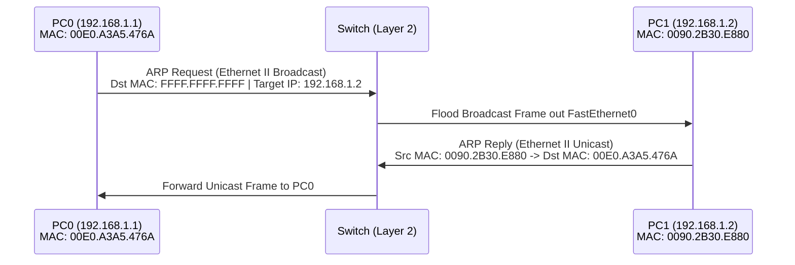

#### Checking ARP Cache on a PC

```cmd
C:\> arp -a

Internet Address      Physical Address      Type
192.168.1.2           0090.2b30.e880        dynamic
```

### Switch MAC Address Table

While a PC uses an **ARP table** (mapping **IP $\leftrightarrow$ MAC**), a Layer 2 Switch uses a **MAC address table** (mapping **MAC Address $\leftrightarrow$ Switch Port & VLAN**).

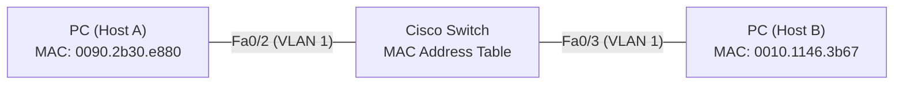

```cisco
Switch# show mac-address-table
          Mac Address Table
-------------------------------------------
Vlan    Mac Address       Type        Ports
----    -----------       --------    -----
   1    0010.1146.3b67    DYNAMIC     Fa0/3
   1    0090.2b30.e880    DYNAMIC     Fa0/2

Switch# clear mac-address-table
```

> [!note] Key Distinction
> - **PC (Layer 3/2):** `arp -a` maps **IP Address $\rightarrow$ MAC Address**.
> - **Switch (Layer 2):** `show mac-address-table` maps **MAC Address $\rightarrow$ Physical Interface (Port)** per VLAN.

---

## 6. VLAN Concepts & Creation

A **VLAN (Virtual Local Area Network)** logically segments a single physical switch into multiple isolated **broadcast domains**. Broadcasts stay contained within their assigned VLAN and do not cross into other VLANs.

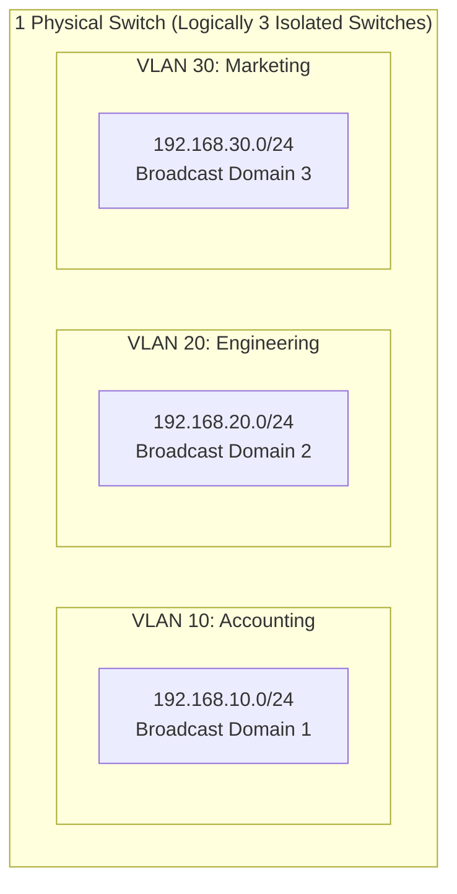

### Creating and Naming a VLAN

```cisco
Switch(config)# vlan 10
Switch(config-vlan)# name Accounting
Switch(config-vlan)# exit
Switch(config)# do show vlan brief
```

---

## 7. Assigning Switch Ports to VLANs (Access Mode)

An **Access Port** (`switchport mode access`) connects to end devices (PCs, servers, printers) and carries traffic for a single VLAN.

```cisco
! Single interface
Switch(config)# interface fa0/2
Switch(config-if)# switchport mode access
Switch(config-if)# switchport access vlan 10

! Consecutive range
Switch(config)# interface range fa0/1-2
Switch(config-if-range)# switchport mode access
Switch(config-if-range)# switchport access vlan 10

! Non-consecutive ports
Switch(config)# interface range fa0/1 , fa0/4
Switch(config-if-range)# switchport mode access
Switch(config-if-range)# switchport access vlan 10
```

### Single-Switch VLAN Lab Topology

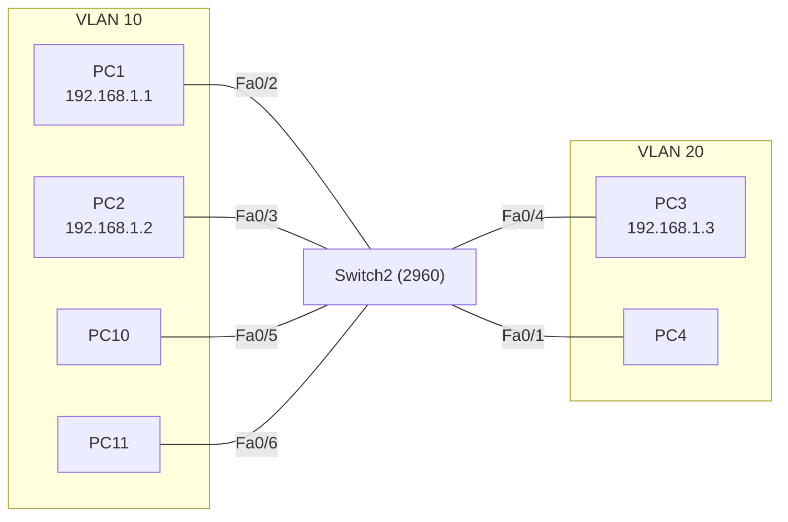

> [!example]- Sample Output: `show vlan brief`
> ```text
> VLAN Name                             Status    Ports
> ---- -------------------------------- --------- -------------------------------
> 1    default                          active    Fa0/5, Fa0/6, Fa0/7, Fa0/8, ...
>                                                 Gig0/1, Gig0/2
> 10   Accounting                       active    Fa0/2, Fa0/3
> 20   Marketing                        active    Fa0/1, Fa0/4
> 1002 fddi-default                     active
> 1003 token-ring-default               active
> 1004 fddinet-default                  active
> 1005 trnet-default                    active
> ```

---

## 8. Trunking (802.1Q)

A **Trunk** link connects switches (or a switch to a router) and carries traffic for **multiple VLANs** simultaneously over a single physical cable.

### Two-Switch Trunk Topology

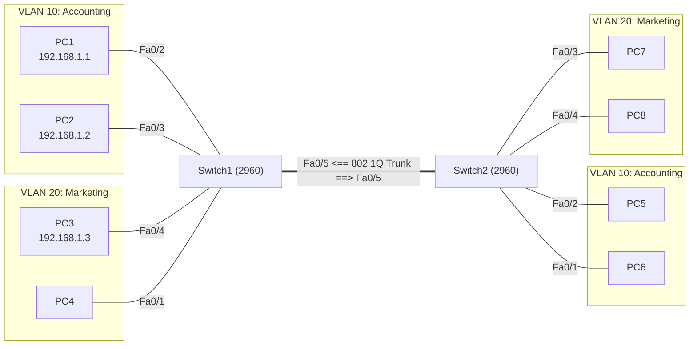

### Configuring a Trunk & Allowed VLANs

```cisco
! Apply on both Switch1 and Switch2
Switch(config)# interface fa0/5
Switch(config-if)# switchport mode trunk

! Allow only VLAN 10 and VLAN 20
Switch(config-if)# switchport trunk allowed vlan 10,20

! Add VLAN 30 without overwriting existing allowed VLANs
Switch(config-if)# switchport trunk allowed vlan add 30

! Remove VLAN 10 from the allowed list
Switch(config-if)# switchport trunk allowed vlan remove 10

! Verify
Switch(config-if)# do show interface trunk
```

> [!warning] Always Use `add` or `remove`
> Running `switchport trunk allowed vlan 30` without the `add` keyword **overwrites** the entire allowed list and drops all other VLANs on that trunk.

### Trunking on a Multilayer Switch (MLS 3560) — 802.1Q vs. ISL

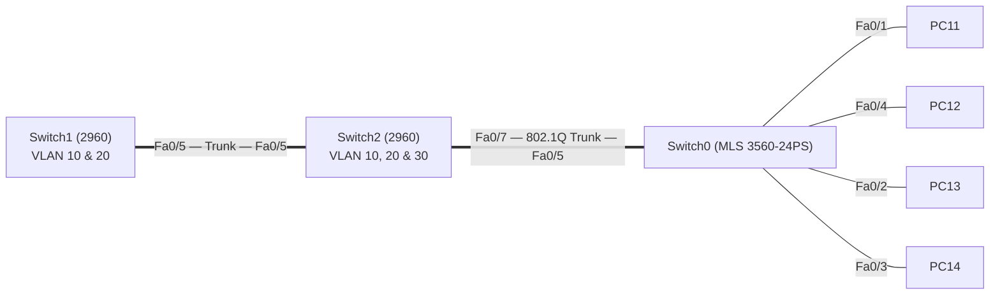

On Multilayer Switches supporting both **ISL** and **802.1Q**, explicitly set `dot1q` encapsulation before `switchport mode trunk`:

```cisco
Switch(config)# interface fa0/5
Switch(config-if)# switchport trunk encapsulation dot1q
Switch(config-if)# switchport mode trunk
```

---

## 9. Dynamic Trunking Protocol (DTP)

**DTP** is a Cisco protocol that automatically negotiates trunking between two switches.

### DTP Negotiation Matrix

| Local Port \ Remote Port | Dynamic Auto | Dynamic Desirable | Trunk | Access |
| :--- | :---: | :---: | :---: | :---: |
| **Dynamic Auto** | ==Access== | Trunk | Trunk | Access |
| **Dynamic Desirable** | Trunk | Trunk | Trunk | Access |
| **Trunk** | Trunk | Trunk | Trunk | ==🔴Limited Connectivity== |
| **Access** | Access | Access | ==🔴Limited Connectivity== | Access |

^dtp-matrix

> [!info] Administrative Mode vs. Operational Mode
> Check both modes using `show interface fa0/5 switchport`:
> - **Administrative Mode:** What you configured (`dynamic auto`, `dynamic desirable`, `trunk`, or `static access`).
> - **Operational Mode:** The active result after DTP negotiation (`trunk` or `static access`).

```cisco
Switch(config)# interface fa0/5
Switch(config-if)# switchport mode dynamic desirable   ! Actively invites trunk
Switch(config-if)# switchport mode dynamic auto        ! Passively waits
Switch# show interface fa0/5 switchport
```

> [!note] Key DTP Rule
> - `dynamic desirable` + `dynamic auto` $\rightarrow$ **Trunk**
> - `dynamic auto` + `dynamic auto` $\rightarrow$ **Static Access** (inter-switch VLAN trunking fails).

---

## 10. 802.1Q Tagging & Native VLAN

### How 802.1Q Tags Frames on a Trunk

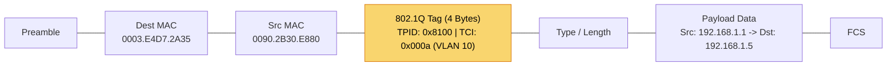

- **TPID (`0x8100`):** Identifies the frame as IEEE 802.1Q tagged.
- **TCI (`0x000a`):** VLAN ID in hexadecimal (`0x000a` $= 10$ $\rightarrow$ **VLAN 10**).

### Native VLAN Configuration

```cisco
! Change Native VLAN to VLAN 20 on the trunk (untagged traffic)
Switch(config)# interface fa0/5
Switch(config-if)# switchport trunk native vlan 20

! Restore Native VLAN back to default (VLAN 1)
Switch(config-if)# switchport trunk native vlan 1
```

---

## 11. Inter-VLAN Routing (Router-on-a-Stick) & DHCP

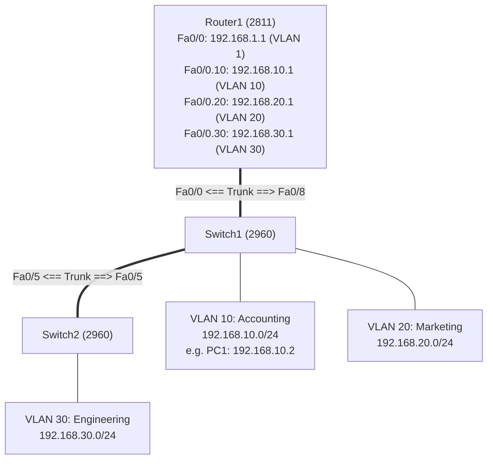

```cisco
! Router1 Sub-interfaces
Router1(config)# interface fa0/0
Router1(config-if)# ip address 192.168.1.1 255.255.255.0
Router1(config-if)# no shutdown

Router1(config)# interface fa0/0.10
Router1(config-subif)# encapsulation dot1q 10
Router1(config-subif)# ip address 192.168.10.1 255.255.255.0

Router1(config)# interface fa0/0.20
Router1(config-subif)# encapsulation dot1q 20
Router1(config-subif)# ip address 192.168.20.1 255.255.255.0

Router1(config)# interface fa0/0.30
Router1(config-subif)# encapsulation dot1q 30
Router1(config-subif)# ip address 192.168.30.1 255.255.255.0

! Switch1 Uplink to Router1
Switch1(config)# interface fa0/8
Switch1(config-if)# switchport mode trunk

! Router1 DHCP Pools
Router1(config)# ip dhcp pool VLAN1
Router1(dhcp-config)# network 192.168.1.0 255.255.255.0
Router1(dhcp-config)# default-router 192.168.1.1
Router1(dhcp-config)# dns-server 8.8.8.8
Router1(dhcp-config)# exit

Router1(config)# ip dhcp pool VLAN20
Router1(dhcp-config)# network 192.168.20.0 255.255.255.0
Router1(dhcp-config)# default-router 192.168.20.1
Router1(dhcp-config)# dns-server 8.8.8.8
Router1(dhcp-config)# exit

Router1(config)# ip dhcp pool VLAN30
Router1(dhcp-config)# network 192.168.30.0 255.255.255.0
Router1(dhcp-config)# default-router 192.168.30.1
Router1(dhcp-config)# dns-server 8.8.8.8
Router1(dhcp-config)# exit
```

---

## 12. Switch Virtual Interface (SVI) on a Multilayer Switch

A **Multilayer Switch (MLS 3560 / 3650)** performs high-speed Inter-VLAN routing internally using **SVIs** once **`ip routing`** is enabled.

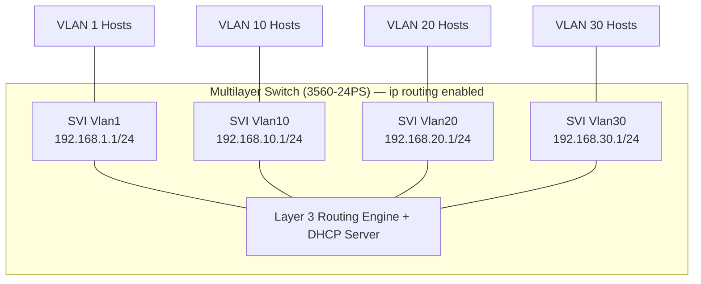

```cisco
! 1. Enable Layer 3 Routing (required — MLS defaults to Layer 2)
Switch(config)# ip routing

! 2. Create SVIs (no dot1q encapsulation needed on SVIs)
Switch(config)# interface vlan 1
Switch(config-if)# ip address 192.168.1.1 255.255.255.0
Switch(config-if)# no shutdown

Switch(config)# interface vlan 10
Switch(config-if)# ip address 192.168.10.1 255.255.255.0
Switch(config-if)# no shutdown

Switch(config)# interface vlan 20
Switch(config-if)# ip address 192.168.20.1 255.255.255.0
Switch(config-if)# no shutdown

Switch(config)# interface vlan 30
Switch(config-if)# ip address 192.168.30.1 255.255.255.0
Switch(config-if)# no shutdown

! 3. Configure DHCP Pools on the MLS
Switch(config)# ip dhcp pool VLAN1
Switch(dhcp-config)# network 192.168.1.0 255.255.255.0
Switch(dhcp-config)# default-router 192.168.1.1
Switch(dhcp-config)# dns-server 8.8.8.8
Switch(dhcp-config)# exit

Switch(config)# ip dhcp pool VLAN10
Switch(dhcp-config)# network 192.168.10.0 255.255.255.0
Switch(dhcp-config)# default-router 192.168.10.1
Switch(dhcp-config)# dns-server 8.8.8.8
Switch(dhcp-config)# exit

! Verify L3 routing table
Switch# show ip route
```
