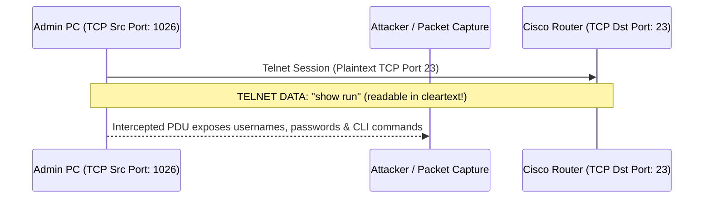
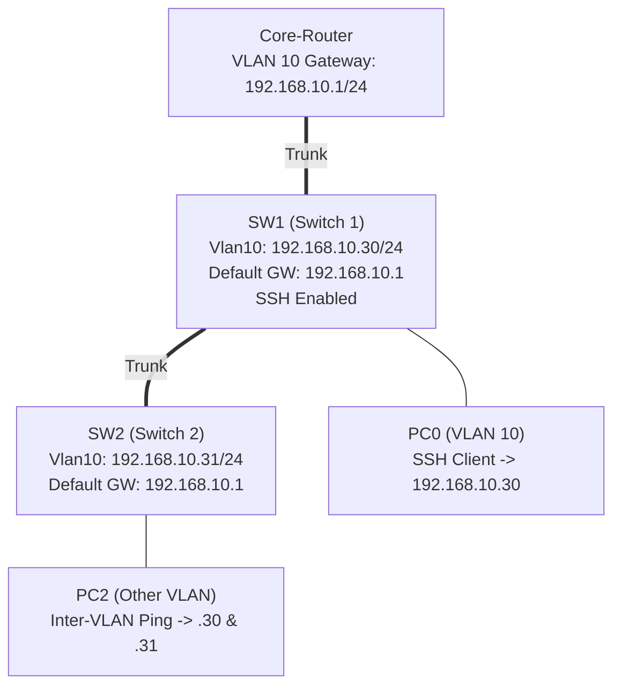
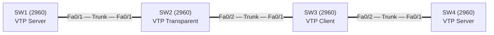
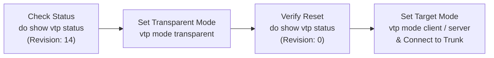
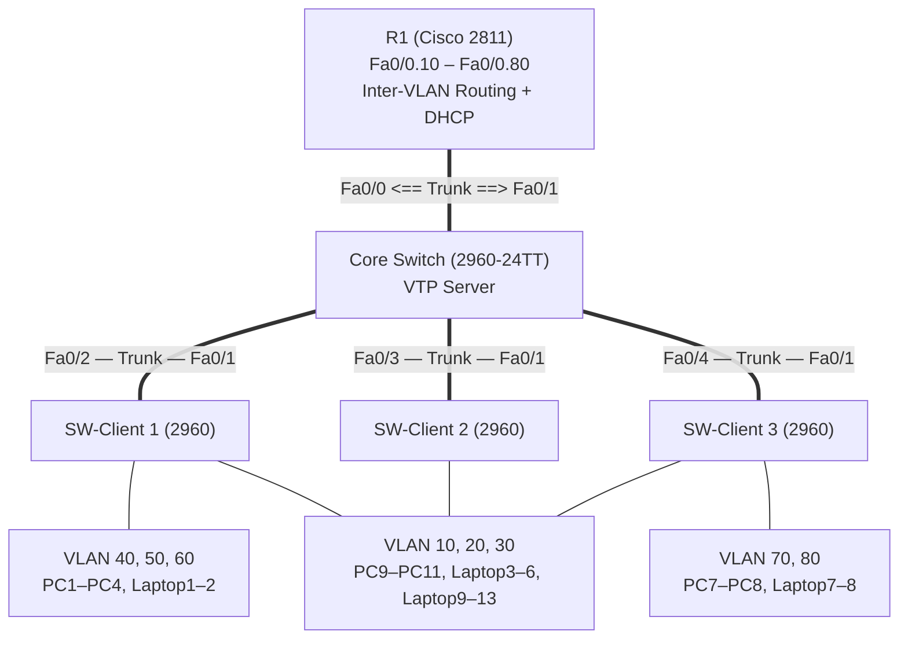
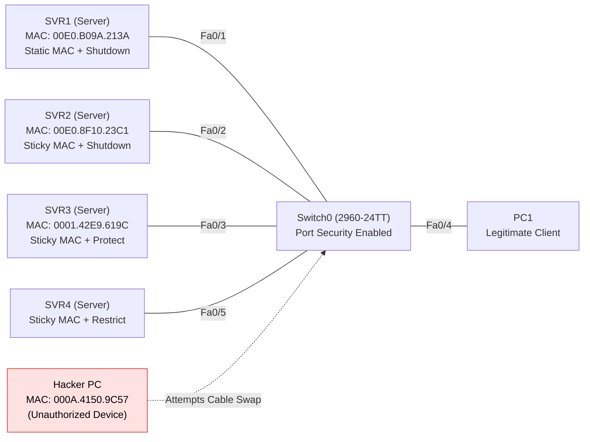
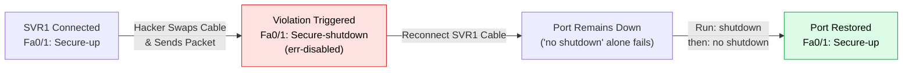

# 02 - Remote Access, VTP & Port Security

> [!abstract] Navigation
> **Previous:** [[01 - Fundamentals, VLANs & Inter-VLAN]] | **Index:** [[00 - Cisco CCNA MOC]] | **Next:** [[03 - STP, EtherChannel & IPv4 Routing]] | **Commands:** [[CCNA Commands & Troubleshooting#11) Switch Security & Port Security|Port Security CLI]]
> **Covers:** PDF Pages 25–43 (Telnet Plaintext Risks, Router & Switch SSH, Switch Management IP & Default Gateway, VTP Modes & Revision Reset, and Switch Port Security: Static MAC, Sticky MAC, & Violation Modes).

---

## 1. Remote Access with Telnet

**Telnet** provides remote CLI access over **TCP Port 23** via Virtual Teletype (`vty`) lines (up to 16 concurrent sessions: `line vty 0 15`).

```cisco
! Basic Telnet (line password only)
Router(config)# enable secret cisco
Router(config)# line vty 0 2
Router(config-line)# password telnet123
Router(config-line)# login
Router(config-line)# transport input telnet
Router(config-line)# exit

! Local Username & Password Authentication
Router(config)# username user1 secret password1
Router(config)# line vty 0 2
Router(config-line)# login local
Router(config-line)# exit
```

> [!info] VTY `transport input` Options
> - `transport input telnet` — Allows **Telnet only**.
> - `transport input ssh` — Allows **SSH only** (recommended).
> - `transport input all` — Allows **both Telnet and SSH**.
> - `enable secret <password>` is **required** to enter Privileged EXEC mode (`#`) remotely.

### Why Telnet Is Insecure (Plaintext Sniffing)



> [!danger] Security Warning
> ==🔴Never use Telnet in production environments.== Always restrict VTY lines to `transport input ssh` so all management traffic is encrypted.

---

## 2. Remote Access with SSH

**SSH (Secure Shell)** encrypts remote management traffic over **TCP Port 22** using RSA keys.

### SSH Prerequisites on Cisco IOS

1. Configure a **Hostname** (cannot remain default `Router` or `Switch`).
2. Configure an **IP Domain Name** (`ip domain-name`).
3. Create a local **Username & Secret** (`username ... secret ...`) and **`enable secret`**.
4. Generate **RSA Crypto Keys** (`crypto key generate rsa` with at least **1024 bits**).
5. Enable `login local` and `transport input ssh` on `line vty`.

### Configuring SSH on a Router

```cisco
Router(config)# hostname Core-Router
Core-Router(config)# enable secret cisco
Core-Router(config)# username user1 secret password1
Core-Router(config)# ip domain-name agunacourse.com

Core-Router(config)# crypto key generate rsa
! How many bits in the modulus [512]: 1024

Core-Router(config)# line vty 0 1
Core-Router(config-line)# login local
Core-Router(config-line)# transport input ssh
Core-Router(config-line)# exit
```

### Switch Management IP, Default Gateway & SSH

A Layer 2 switch needs a management **SVI** (`interface vlan 10`) and an **`ip default-gateway`** to be managed from other VLANs or subnets.



```cisco
! --- Full Switch SSH Configuration (SW1) ---
Switch(config)# interface vlan 10
Switch(config-if)# ip address 192.168.10.30 255.255.255.0
Switch(config-if)# no shutdown
Switch(config-if)# exit
Switch(config)# ip default-gateway 192.168.10.1

Switch(config)# hostname SW1
SW1(config)# enable secret cisco
SW1(config)# username user1 secret password1
SW1(config)# ip domain-name agunacourse.com
SW1(config)# crypto key generate rsa
! How many bits in the modulus [512]: 1024

SW1(config)# line vty 0 4
SW1(config-line)# login local
SW1(config-line)# transport input ssh
SW1(config-line)# exit

! --- SW2 Management IP ---
Switch(config)# interface vlan 10
Switch(config-if)# ip address 192.168.10.31 255.255.255.0
Switch(config-if)# no shutdown
Switch(config-if)# exit
Switch(config)# ip default-gateway 192.168.10.1
```

> [!tip] Initial Ping Packet Loss (ARP Resolution)
> Seeing 1 timed-out packet (`80%` success rate) on the first ping is normal while switches and hosts resolve MAC addresses via [[01 - Fundamentals, VLANs & Inter-VLAN#5. ARP Table (PC) vs. MAC Address Table (Switch)|ARP]].

---

## 3. VLAN Trunking Protocol (VTP)

**VTP** automatically propagates VLAN database changes across trunked switches belonging to the same **VTP Domain**.



| VTP Mode | Create / Modify / Delete VLANs | Propagates Own Changes | Syncs Database from VTP | Forwards VTP Advertisements |
| :--- | :---: | :---: | :---: | :---: |
| **Server** | Yes | Yes | Yes | Yes |
| **Transparent** | Yes (local only) | No | No | Yes (passes through) |
| **Client** | No | No | Yes | Yes |

^vtp-modes

```cisco
! All switches must share the exact same Domain Name & Password
Switch(config)# vtp mode server        ! Options: server | transparent | client
Switch(config)# vtp domain AGUNACOURSE
Switch(config)# vtp password 123
```

### Solving the VTP Revision Number Problem

> [!danger] The VTP Overwrite Hazard
> VTP trusts the **highest `Configuration Revision` number**. Plugging in a used switch (even in **Client** mode) with a higher revision (e.g., `14`) ==🔴will overwrite the entire production VLAN database==.



```cisco
Switch(config)# do show vtp status       ! Revision: 14
Switch(config)# vtp mode transparent     ! Resets Revision to 0
Switch(config)# do show vtp status       ! Revision: 0
```

### VTP + Router-on-a-Stick Lab Topology



---

## 4. Switch Port Security

**Port Security** restricts access on a switch access port by limiting allowed **MAC addresses** and defining an action when an unauthorized device connects.



> [!important] Prerequisite: Static Access Mode Required
> Enabling `switchport port-security` on a default `dynamic auto` port is rejected (`Command rejected: FastEthernet0/5 is a dynamic port.`). Always configure **`switchport mode access`** first.

### Static MAC & Shutdown Violation (`Fa0/1`)

```cisco
Switch(config)# interface fa0/1
Switch(config-if)# switchport mode access
Switch(config-if)# switchport port-security
Switch(config-if)# switchport port-security mac-address 00E0.B09A.213A
Switch(config-if)# switchport port-security maximum 1
Switch(config-if)# switchport port-security violation shutdown
```

#### Violation & Recovery Workflow



```cisco
! Recovering an err-disabled (Secure-shutdown) port
Switch(config)# interface fa0/1
Switch(config-if)# shutdown
Switch(config-if)# no shutdown
Switch(config-if)# do show port-security interface fa0/1
```

---

### Sticky MAC Learning (`Fa0/2`) & Violation Modes Comparison

| Violation Mode | Drops Unauthorized Frames | Increments Violation Counter & Logs | Shuts Down Port (`err-disabled`) | Manual Recovery Needed |
| :--- | :---: | :---: | :---: | :---: |
| **`protect`** | Yes | **No** (stays `0`) | No (stays `Secure-up`) | No |
| **`restrict`** | Yes | **Yes** (logs & counts each violation) | No (stays `Secure-up`) | No |
| **`shutdown`** *(default)* | Yes | **Yes** | ==🔴Yes (`Secure-shutdown`)== | ==Yes (`shut` / `no shut`)== |

^violation-modes

```cisco
! Sticky MAC + Shutdown (Fa0/2)
Switch(config)# interface fa0/2
Switch(config-if)# switchport mode access
Switch(config-if)# switchport port-security
Switch(config-if)# switchport port-security mac-address sticky
Switch(config-if)# switchport port-security maximum 1
Switch(config-if)# switchport port-security violation shutdown

! Sticky MAC + Protect (Fa0/3 — silent drop, counter stays 0, port stays up)
Switch(config)# interface fa0/3
Switch(config-if)# switchport mode access
Switch(config-if)# switchport port-security
Switch(config-if)# switchport port-security mac-address sticky
Switch(config-if)# switchport port-security maximum 1
Switch(config-if)# switchport port-security violation protect

! Sticky MAC + Restrict (Fa0/5 — drops frames, increments counter, port stays up)
Switch(config)# interface fa0/5
Switch(config-if)# switchport mode access
Switch(config-if)# switchport port-security
Switch(config-if)# switchport port-security mac-address sticky
Switch(config-if)# switchport port-security maximum 1
Switch(config-if)# switchport port-security violation restrict
```
