# 03 - STP, EtherChannel & IPv4 Routing

> [!abstract] Navigation
> **Previous:** [[02 - Remote Access, VTP & Port Security]] | **Index:** [[00 - Cisco CCNA MOC]] | **Next:** [[04 - ACL, NAT & IPv6]] | **Commands:** [[CCNA Commands & Troubleshooting#4) STP, EtherChannel & CDP|STP/EC]] • [[CCNA Commands & Troubleshooting#6) OSPF|OSPF]] • [[CCNA Commands & Troubleshooting#7) EIGRP|EIGRP]] • [[CCNA Commands & Troubleshooting#7B) BGP (eBGP Basics)|BGP]]
> **Covers:** PDF Pages 44–76 (STP Election, Cost & Speed Manipulation, PVSTP Load Balancing, Port States & PortFast, EtherChannel LACP/PAgP/L3, Static Routing 1–4 Routers, EIGRP, Single/Multi-Area OSPF, IGP vs. EGP, and eBGP).

---

## 1. Spanning Tree Protocol (STP) Fundamentals

**STP (IEEE 802.1D)** is enabled by default on Cisco switches to prevent **Layer 2 switching loops** in redundant topologies.

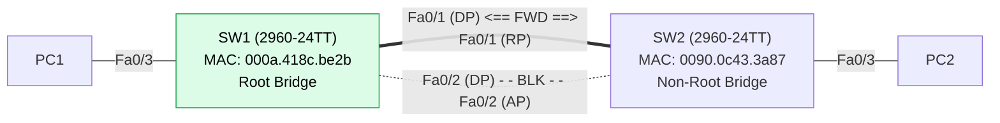

$$
\text{Bridge ID} = \text{Priority (Default } 32768\text{)} + \text{VLAN ID (Extended System ID)} + \text{MAC Address}
$$

> [!info] Election Rules (Lowest Value Always Wins)
> 1. **Root Bridge (RB):** Lowest Priority; tie-breaker is lowest MAC address.
> 2. **Designated Port (DP — FWD):** All ports on the Root Bridge, plus the lowest-cost/lowest-BID side on every remaining link.
> 3. **Root Port (RP — FWD):** One port per Non-Root switch with the lowest cumulative path cost to the Root Bridge.
> 4. **Alternate Port (AP — BLK):** Any remaining port is blocked to break the loop.

### 3-Switch Election Lab (`show interface vlan 1` & `show spanning-tree`)

| Switch | Base MAC Address | Bridge Priority (VLAN 1) | Role |
| :---: | :--- | :---: | :--- |
| **SWA** | `0090.0c70.75e4` | `32769` | Non-Root Bridge (`Fa0/2` Blocked) |
| **SWB** | ==`0009.7c1b.5d12`== | `32769` | ==Root Bridge== (Lowest MAC) |
| **SWC** | `0060.4717.c883` | `32769` | Non-Root Bridge |

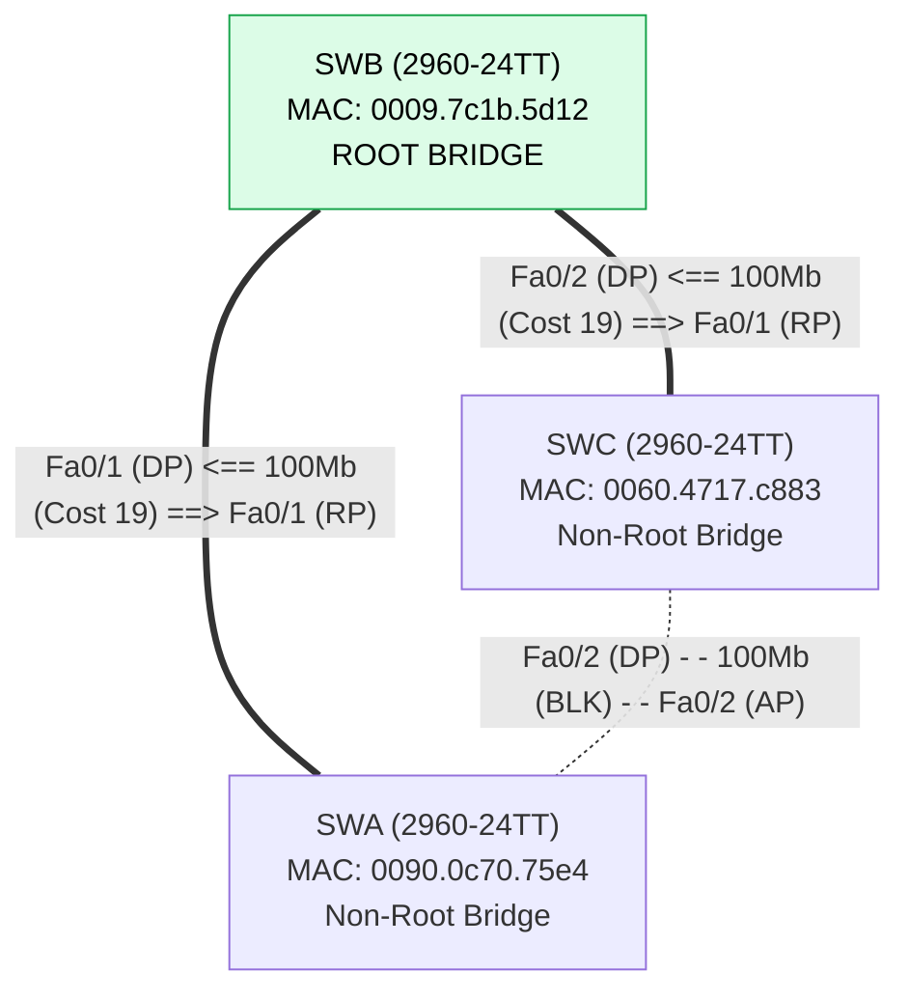

### STP Path Cost & Bandwidth Manipulation

| Link Bandwidth | IEEE STP Cost |
| :---: | :---: |
| **10 Mbps** | `100` |
| **100 Mbps** | `19` |
| **1 Gbps** | `4` |
| **10 Gbps** | `2` |

^stp-cost-table

Forcing `Fa0/1` between `SWA` and `SWB` to **10 Mbps** (`speed 10`) raises its cost from `19` to `100`. Since the 2-hop path via `SWC` costs $19 + 19 = 38 < 100$, `SWA` moves its **Root Port** to `Fa0/2` and blocks `Fa0/1`:

```cisco
! Apply on both SWA and SWB
Switch(config)# interface fa0/1
Switch(config-if)# speed 10
```

---

## 2. PVSTP Load Balancing, Port States & PortFast

### Per-VLAN Spanning Tree (`PVST+`) Load Balancing

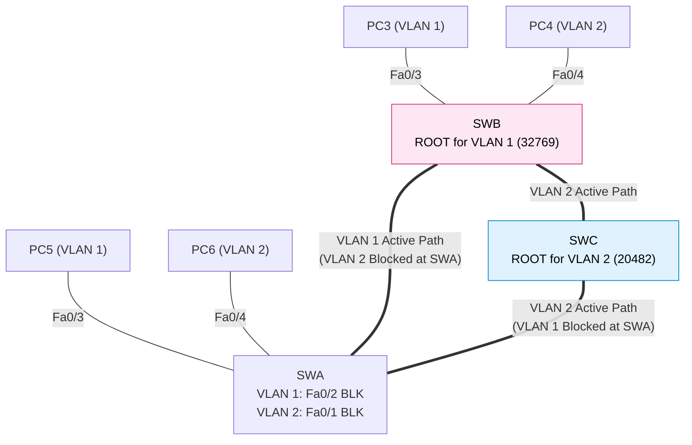

```cisco
! Make SWC the Root Bridge for VLAN 2 (priority must be a multiple of 4096)
SWC(config)# spanning-tree vlan 2 priority 20480

! Or use root primary / secondary macro (sets priority to 24576 / 28672)
SW2(config)# spanning-tree vlan 1 root primary
```

### Standard STP Port States & PortFast

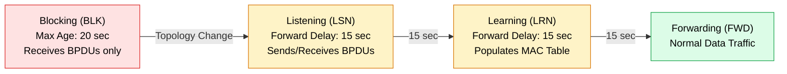

```cisco
! Skip 30-second Listening/Learning delay on end-host access ports ONLY
SW1(config)# interface fa0/3
SW1(config-if)# spanning-tree portfast
```

> [!danger] PortFast Safety Warning
> ==🔴Never enable PortFast on switch-to-switch links.== Use it only on access ports connected to single end hosts (pair with `spanning-tree bpduguard enable` in production).

---

## 3. EtherChannel (LACP, PAgP & Layer 3)

**EtherChannel** bundles multiple physical cables into a single logical `Port-channel` (e.g., $3 \times 100\text{ Mbps} = 300\text{ Mbps}$) without STP blocking.

| Protocol | Layer | Vendor Support | Compatible Mode Pairs | Incompatible Pair |
| :--- | :---: | :--- | :--- | :--- |
| **LACP** (`802.3ad`) | Layer 2 | ==Open Standard (All Vendors)== | `active`+`active`, `active`+`passive` | `passive`+`passive` |
| **PAgP** | Layer 2 | Cisco Proprietary | `desirable`+`desirable`, `desirable`+`auto` | `auto`+`auto` |
| **Layer 3 EtherChannel** | Layer 3 | Multilayer Switch (`3560`/`3650`) | `no switchport` + `mode on` | — |

^etherchannel-types

### Layer 2 EtherChannel Lab (LACP + PAgP)

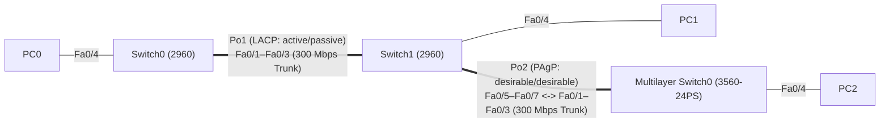

```cisco
! --- LACP: Switch0 (Group 1, active) <-> Switch1 (Group 1, passive) ---
Switch0(config)# interface range fa0/1-3
Switch0(config-if-range)# switchport mode trunk
Switch0(config-if-range)# channel-group 1 mode active

Switch1(config)# interface range fa0/1-3
Switch1(config-if-range)# switchport mode trunk
Switch1(config-if-range)# channel-group 1 mode passive

! --- PAgP: Switch1 (Group 2, desirable) <-> MLS0 (Group 2, desirable) ---
Switch1(config)# interface range fa0/5-7
Switch1(config-if-range)# switchport mode trunk
Switch1(config-if-range)# channel-group 2 mode desirable

MLS0(config)# interface range fa0/1-3
MLS0(config-if-range)# switchport trunk encapsulation dot1q
MLS0(config-if-range)# switchport mode trunk
MLS0(config-if-range)# channel-group 2 mode desirable

! Verify: Po1(SU) LACP | Po2(SU) PAgP  (S=Layer2, U=In Use, P=In Port-Channel)
Switch1# show etherchannel summary
```

### Layer 3 EtherChannel (`MLS1` $\leftrightarrow$ `MLS2`)

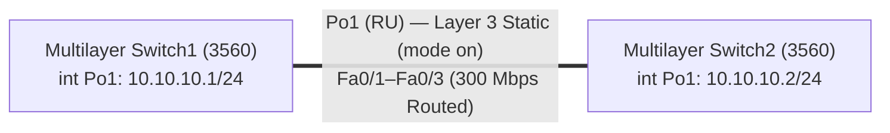

```cisco
MLS1(config)# interface range fa0/1-3
MLS1(config-if-range)# no switchport
MLS1(config-if-range)# channel-group 1 mode on
MLS1(config-if-range)# exit
MLS1(config)# interface po1
MLS1(config-if)# ip address 10.10.10.1 255.255.255.0
! Verify: Po1(RU)  (R=Layer3, U=In Use)
```

---

## 4. Static Routing (1 to 4 Routers + VLANs)

Syntax: `ip route <destination-network> <subnet-mask> <next-hop-ip>`

### 3-Router Static Topology (5 Networks)

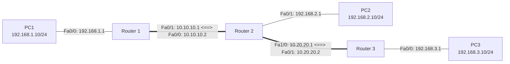

```cisco
! Router 1
R1(config)# ip route 192.168.2.0 255.255.255.0 10.10.10.2
R1(config)# ip route 10.20.20.0 255.255.255.0 10.10.10.2
R1(config)# ip route 192.168.3.0 255.255.255.0 10.10.10.2

! Router 2 (middle router asks R1 for left networks and R3 for right networks)
R2(config)# ip route 192.168.1.0 255.255.255.0 10.10.10.1
R2(config)# ip route 192.168.3.0 255.255.255.0 10.20.20.2

! Router 3
R3(config)# ip route 192.168.2.0 255.255.255.0 10.20.20.1
R3(config)# ip route 10.10.10.0 255.255.255.0 10.20.20.1
R3(config)# ip route 192.168.1.0 255.255.255.0 10.20.20.1
```

### 4-Router + VLANs 40 & 50 Topology (9 Total Paths)

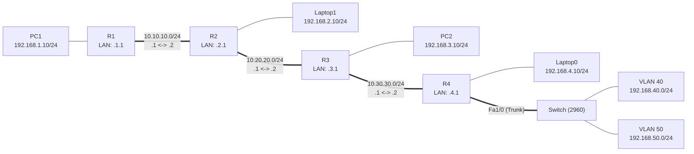

> [!example]- Complete 9-Path Static Routing Matrix
>
> | Destination Network | Router 1 | Router 2 | Router 3 | Router 4 |
> | :--- | :--- | :--- | :--- | :--- |
> | `192.168.1.0/24` | `C` (`Fa0/0`) | `S` via `10.10.10.1` | `S` via `10.20.20.1` | `S` via `10.30.30.1` |
> | `10.10.10.0/24` | `C` (`Fa0/1`) | `C` (`Fa0/0`) | `S` via `10.20.20.1` | `S` via `10.30.30.1` |
> | `192.168.2.0/24` | `S` via `10.10.10.2` | `C` (`Fa0/1`) | `S` via `10.20.20.1` | `S` via `10.30.30.1` |
> | `10.20.20.0/24` | `S` via `10.10.10.2` | `C` (`Fa1/0`) | `C` (`Fa0/1`) | `S` via `10.30.30.1` |
> | `192.168.3.0/24` | `S` via `10.10.10.2` | `S` via `10.20.20.2` | `C` (`Fa0/0`) | `S` via `10.30.30.1` |
> | `10.30.30.0/24` | `S` via `10.10.10.2` | `S` via `10.20.20.2` | `C` (`Fa1/0`) | `C` (`Fa0/0`) |
> | `192.168.4.0/24` | `S` via `10.10.10.2` | `S` via `10.20.20.2` | `S` via `10.30.30.2` | `C` (`Fa0/1`) |
> | `192.168.40.0/24` (VLAN 40) | `S` via `10.10.10.2` | `S` via `10.20.20.2` | `S` via `10.30.30.2` | `C` (`Fa1/0.40`) |
> | `192.168.50.0/24` (VLAN 50) | `S` via `10.10.10.2` | `S` via `10.20.20.2` | `S` via `10.30.30.2` | `C` (`Fa1/0.50`) |

---

## 5. Dynamic Routing: EIGRP, OSPF & BGP

| Protocol | Category | Standard | Route Code / AD | Primary Use Case |
| :--- | :---: | :--- | :---: | :--- |
| **EIGRP** | IGP | Cisco Proprietary | `D` / `90` | Cisco-only enterprises; fast convergence, unequal-cost load balancing |
| **OSPF** | IGP | ==Open Standard== | `O` / `110` | Multi-vendor enterprises; link-state, hierarchical areas & backbone |
| **IS-IS** | IGP | ==Open Standard== | `i` / `115` | Very large ISP core networks |
| **BGP** | **EGP** | ==Open Standard== | `B` / `20` (eBGP) | Routing **between Autonomous Systems (AS)** across the global Internet |

^dynamic-routing-comparison

### A. EIGRP (Autonomous System Number Must Match)

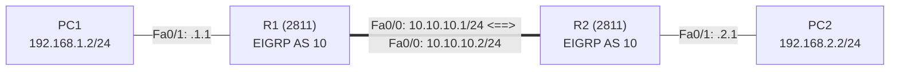

```cisco
! Router 1
R1(config)# router eigrp 10
R1(config-router)# network 10.10.10.0
R1(config-router)# network 192.168.1.0

! Router 2
R2(config)# router eigrp 10
R2(config-router)# network 10.10.10.0
R2(config-router)# network 192.168.2.0

! Verify
R2# show ip eigrp neighbors
R2# show ip route
```

---

### B. OSPF (Single-Area & Multi-Area)

Wildcard Mask Formula: $\text{Wildcard Mask} = 255.255.255.255 - \text{Subnet Mask}$ (`/24` $\rightarrow$ `0.0.0.255`, `/30` $\rightarrow$ `0.0.0.3`).

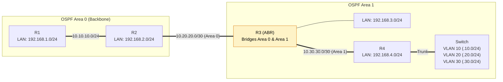

```cisco
! Router 1 (Area 0)
router ospf 1
 network 10.10.10.0 0.0.0.255 area 0
 network 192.168.1.0 0.0.0.255 area 0

! Router 2 (Area 0)
router ospf 1
 network 10.10.10.0 0.0.0.255 area 0
 network 192.168.2.0 0.0.0.255 area 0
 network 10.20.20.0 0.0.0.3 area 0

! Router 3 (ABR — bridges Area 0 and Area 1)
router ospf 1
 network 10.20.20.0 0.0.0.3 area 0
 network 192.168.3.0 0.0.0.255 area 1
 network 10.30.30.0 0.0.0.3 area 1

! Router 4 (Area 1)
router ospf 1
 network 10.30.30.0 0.0.0.3 area 1
 network 192.168.4.0 0.0.0.255 area 1
 network 192.168.10.0 0.0.0.255 area 1
 network 192.168.20.0 0.0.0.255 area 1
 network 192.168.30.0 0.0.0.255 area 1
```

---

### C. IGP vs. EGP & eBGP (2-Router & 3-Router Labs)

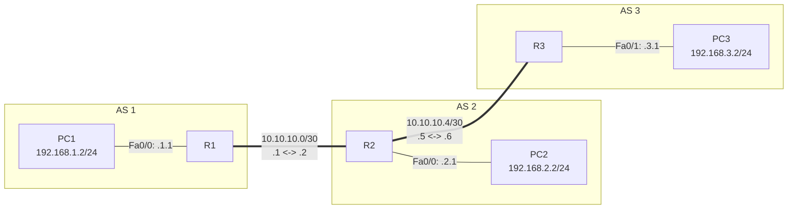

```cisco
! --- Router 1 (AS 1) ---
R1(config)# router bgp 1
R1(config-router)# neighbor 10.10.10.2 remote-as 2
R1(config-router)# network 10.10.10.0 mask 255.255.255.252
R1(config-router)# network 192.168.1.0 mask 255.255.255.0

! --- Router 2 (AS 2) ---
R2(config)# router bgp 2
R2(config-router)# neighbor 10.10.10.1 remote-as 1
R2(config-router)# neighbor 10.10.10.6 remote-as 3
R2(config-router)# network 10.10.10.0 mask 255.255.255.252
R2(config-router)# network 10.10.10.4 mask 255.255.255.252
R2(config-router)# network 192.168.2.0 mask 255.255.255.0

! --- Router 3 (AS 3) ---
R3(config)# router bgp 3
R3(config-router)# neighbor 10.10.10.5 remote-as 2
R3(config-router)# network 10.10.10.4 mask 255.255.255.252
R3(config-router)# network 192.168.3.0 mask 255.255.255.0
```

> [!warning] Troubleshooting BGP State
> In `show ip bgp summary`, a **number** under `State/PfxRcd` confirms an **Established** session receiving prefixes. **`Active`** or **`Idle`** means peering has failed.
