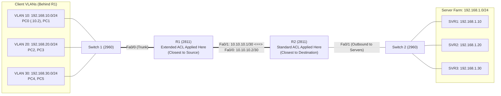
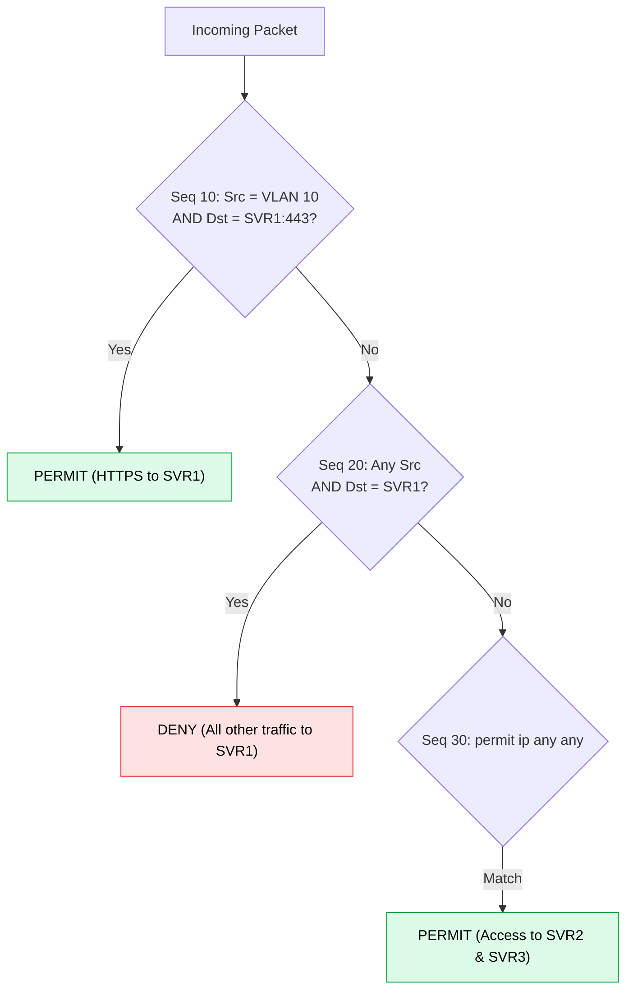
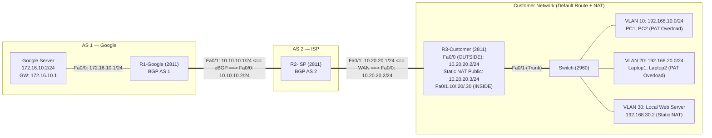
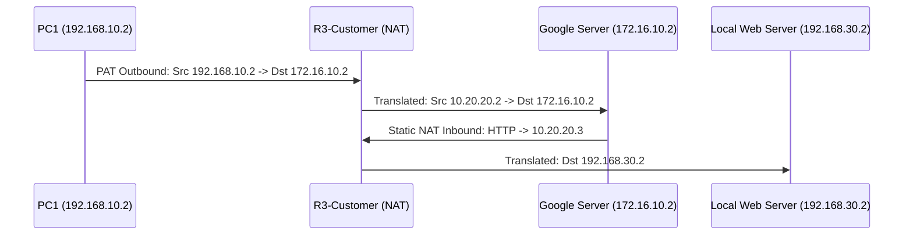
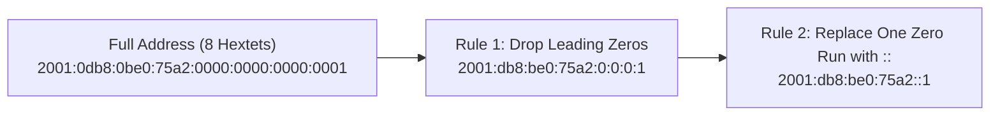
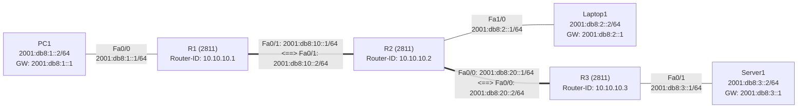

# 04 - ACL, NAT & IPv6

> [!abstract] Navigation
> **Previous:** [[03 - STP, EtherChannel & IPv4 Routing]] | **Index:** [[00 - Cisco CCNA MOC]] | **Commands:** [[CCNA Commands & Troubleshooting#9) ACLs — Complete Reference|ACL]] • [[CCNA Commands & Troubleshooting#10) DHCP, NAT & Management|NAT]] • [[CCNA Commands & Troubleshooting#8) IPv6|IPv6]]
> **Covers:** PDF Pages 77–94 (Standard & Extended ACLs, Sequence Numbers, Named ACLs, Default Routing, Dynamic NAT / PAT Overload, Static NAT, IPv6 Address Types, Compression/Uncompression, IPv6 Static Routing, OSPFv3, and EIGRPv6).

---

## 1. Access Control Lists (ACL)

| Feature | Standard ACL | Extended ACL |
| :--- | :--- | :--- |
| **Number Range** | `1–99` (`1300–1999`) or Named | `100–199` (`2000–2699`) or Named |
| **Filtering Criteria** | ==Source IP / Network only== | ==Source IP, Destination IP, Protocol & Port== |
| **Placement Best Practice** | **Closest to Destination** (`R2`) | **Closest to Source** (`R1`) |
| **Evaluation Logic** | Top-down first-match + implicit **`deny any`** | Top-down first-match + implicit **`deny ip any any`** |

^acl-comparison

### ACL Lab Topology



### Standard ACL, Sequence Editing & Named Standard ACL (`R2`)

```cisco
! 1. Block VLAN 20, permit everything else
R2(config)# access-list 1 deny 192.168.20.0 0.0.0.255
R2(config)# access-list 1 permit any
R2(config)# interface fa0/1
R2(config-if)# ip access-group 1 out

! 2. Re-order rule priority using Sequence Numbers (insert before seq 20)
R2(config)# ip access-list standard 1
R2(config-std-nacl)# no 30
R2(config-std-nacl)# 15 deny host 192.168.10.2

! 3. Named Standard ACL (Only Permit VLAN 30; implicit deny blocks others)
R2(config)# ip access-list standard PermitVLAN30
R2(config-std-nacl)# permit 192.168.30.0 0.0.0.255
R2(config)# interface fa0/1
R2(config-if)# ip access-group PermitVLAN30 out
```

### Extended & Named Extended ACL (`R1`)



```cisco
! Case A: Numbered Extended ACL 100 (Block HTTP to all servers + per-VLAN server access)
R1(config)# access-list 100 deny tcp any 192.168.1.0 0.0.0.255 eq 80
R1(config)# access-list 100 permit ip any host 192.168.1.10
R1(config)# access-list 100 permit ip 192.168.20.0 0.0.0.255 host 192.168.1.20
R1(config)# access-list 100 permit ip 192.168.30.0 0.0.0.255 host 192.168.1.30
R1(config)# interface fa0/1
R1(config-if)# ip access-group 100 out

! Case B: Named Extended ACL (VLAN 10 HTTPS only to SVR1; block all else to SVR1; allow SVR2/3)
R1(config)# interface fa0/1
R1(config-if)# no ip access-group 100 out
R1(config)# ip access-list extended ACL
R1(config-ext-nacl)# permit tcp 192.168.10.0 0.0.0.255 host 192.168.1.10 eq 443
R1(config-ext-nacl)# deny ip any host 192.168.1.10
R1(config-ext-nacl)# permit ip any any
R1(config)# interface fa0/1
R1(config-if)# ip access-group ACL out
```

---

## 2. Default Routing & NAT (Dynamic/PAT & Static)

| NAT Type | Mapping | Primary Use Case |
| :--- | :---: | :--- |
| **Static NAT** | **One-to-One** | Publishing an internal web/mail server on a fixed Public IP |
| **Dynamic NAT** | **Pool-Based** | Outbound Internet access from a shared pool of public IPs |
| **PAT / Overload** | **Many-to-One (+ Ports)** | Most common in homes & offices; shares 1 Public IP across many clients |

^nat-types



### PAT Overload Flow (Outbound) & Static NAT Flow (Inbound)



```cisco
! 1. Default Route (Gateway of Last Resort) toward ISP
R3-Customer(config)# ip route 0.0.0.0 0.0.0.0 10.20.20.1

! 2. PAT / Dynamic NAT Overload for VLAN 10 & VLAN 20
R3-Customer(config)# access-list 1 permit 192.168.10.0 0.0.0.255
R3-Customer(config)# access-list 1 permit 192.168.20.0 0.0.0.255
R3-Customer(config)# ip nat inside source list 1 interface fa0/0 overload

! 3. Static NAT (One-to-One) for Internal Web Server (192.168.30.2 -> 10.20.20.3)
R3-Customer(config)# ip nat inside source static 192.168.30.2 10.20.20.3

! 4. Mark Outside (ISP) and Inside (LAN/VLAN) interfaces
R3-Customer(config)# interface fa0/0
R3-Customer(config-if)# ip nat outside
R3-Customer(config)# interface fa0/1.10
R3-Customer(config-subif)# ip nat inside
R3-Customer(config)# interface fa0/1.20
R3-Customer(config-subif)# ip nat inside
R3-Customer(config)# interface fa0/1.30
R3-Customer(config-subif)# ip nat inside
```

---

## 3. IPv6 Addressing, Types & Compression

### IPv6 Address Types

| Address Type | Prefix / Range | Internet Routable? | IPv4 Equivalent | Primary Purpose |
| :--- | :--- | :---: | :--- | :--- |
| **Link-Local** | `FE80::/10` | No | APIPA (`169.254.0.0/16`) | Single-link communication, **SLAAC**, & **NDP** |
| **Global Unicast** | `2000::/3` | ==Yes== | Public IPv4 | Globally unique Internet-routable addresses |
| **Unique Local (ULA)** | `FC00::/7` (`FD00::/8`) | No | Private IPv4 (RFC 1918) | Internal private organizational networks |

^ipv6-address-types

### IPv4 vs. IPv6 Quick Comparison

| Feature | IPv4 | IPv6 |
| :--- | :--- | :--- |
| **Address Space** | `32 bits` (Decimal `.`) | `128 bits` (Hexadecimal `:`) |
| **Possible Addresses** | $\approx 4.29 \times 10^9$ | $\approx 3.4 \times 10^{38}$ |
| **Typical LAN Prefix** | `/24` (3 net + 1 host octets) | `/64` (4 net + 4 host hextets) |

### Address Compression Rules



> [!danger] Critical Rule: Use `::` Only Once!
> For `2001:0db8:0000:0000:0010:0000:0000:0001`:
> - ==🔴Wrong:== `2001:db8::10::1`
> - ==🟢Correct:== `2001:db8::10:0:0:1` **or** `2001:db8:0:0:10::1`

> [!example]- Compression & Uncompression Exercises
> - `2001:0db8:0ab0:0000:0000:0000:0000:0c01` $\rightarrow$ `2001:db8:ab0::c01`
> - `2001:0db8:0000:4c05:0000:0000:05ad:0bb1` $\rightarrow$ `2001:db8:0:4c05::5ad:bb1`
> - `2001:0db8:0000:0000:1234:0000:0000:da61` $\rightarrow$ `2001:db8::1234:0:0:da61`
> - `2001:db8:ab::c0c1` $\rightarrow$ `2001:0db8:00ab:0000:0000:0000:0000:c0c1`
> - `2001:db8:2000:c05:60::1` $\rightarrow$ `2001:0db8:2000:0c05:0060:0000:0000:0001`
> - `2001:db8:0:1234::61` $\rightarrow$ `2001:0db8:0000:1234:0000:0000:0000:0061`

---

## 4. IPv6 Routing (Static, OSPFv3 & EIGRPv6)



### A. IPv6 Static Routing

```cisco
! Enable IPv6 routing globally on R1, R2, and R3
R1(config)# ipv6 unicast-routing
R1(config)# ipv6 route 2001:db8:2::/64 2001:db8:10::2
R1(config)# ipv6 route 2001:db8:20::/64 2001:db8:10::2
R1(config)# ipv6 route 2001:db8:3::/64 2001:db8:10::2

R2(config)# ipv6 unicast-routing
R2(config)# ipv6 route 2001:db8:1::/64 2001:db8:10::1
R2(config)# ipv6 route 2001:db8:3::/64 2001:db8:20::2

R3(config)# ipv6 unicast-routing
R3(config)# ipv6 route 2001:db8:2::/64 2001:db8:20::1
R3(config)# ipv6 route 2001:db8:10::/64 2001:db8:20::1
R3(config)# ipv6 route 2001:db8:1::/64 2001:db8:20::1
```

### B. OSPFv3 (Enabled Directly per Interface)

```cisco
! --- Router 1 ---
R1(config)# ipv6 router ospf 1
R1(config-rtr)# router-id 10.10.10.1
R1(config)# interface fa0/0
R1(config-if)# ipv6 ospf 1 area 0
R1(config)# interface fa0/1
R1(config-if)# ipv6 ospf 1 area 0

! --- Router 2 ---
R2(config)# ipv6 router ospf 2
R2(config-rtr)# router-id 10.10.10.2
R2(config)# interface fa0/0
R2(config-if)# ipv6 ospf 2 area 0
R2(config)# interface fa0/1
R2(config-if)# ipv6 ospf 2 area 0
R2(config)# interface fa1/0
R2(config-if)# ipv6 ospf 2 area 0

! --- Router 3 ---
R3(config)# ipv6 router ospf 3
R3(config-rtr)# router-id 10.10.10.3
R3(config)# interface fa0/0
R3(config-if)# ipv6 ospf 3 area 0
R3(config)# interface fa0/1
R3(config-if)# ipv6 ospf 3 area 0
```

### C. EIGRP for IPv6 (Requires `no shutdown` & Matching AS)

```cisco
! --- Router 1 ---
R1(config)# ipv6 router eigrp 10
R1(config-rtr)# eigrp router-id 10.10.10.1
R1(config-rtr)# no shutdown
R1(config)# interface fa0/0
R1(config-if)# ipv6 eigrp 10
R1(config)# interface fa0/1
R1(config-if)# ipv6 eigrp 10

! --- Router 2 ---
R2(config)# ipv6 router eigrp 10
R2(config-rtr)# eigrp router-id 10.10.10.2
R2(config-rtr)# no shutdown
R2(config)# interface fa0/0
R2(config-if)# ipv6 eigrp 10
R2(config)# interface fa0/1
R2(config-if)# ipv6 eigrp 10
R2(config)# interface fa1/0
R2(config-if)# ipv6 eigrp 10

! --- Router 3 ---
R3(config)# ipv6 router eigrp 10
R3(config-rtr)# eigrp router-id 10.10.10.3
R3(config-rtr)# no shutdown
R3(config)# interface fa0/0
R3(config-if)# ipv6 eigrp 10
R3(config)# interface fa0/1
R3(config-if)# ipv6 eigrp 10
```

| Feature | OSPFv3 | EIGRPv6 |
| :--- | :--- | :--- |
| **Prerequisite** | `ipv6 unicast-routing` | `ipv6 unicast-routing` |
| **Router ID Command** | `router-id <a.b.c.d>` | `eigrp router-id <a.b.c.d>` |
| **Process Activation** | Active by default | ==Requires `no shutdown`== |
| **ID Matching** | Process ID is local; **Area ID must match** | **AS Number must match** |
| **Interface Command** | `ipv6 ospf <pid> area <id>` | `ipv6 eigrp <as>` |
