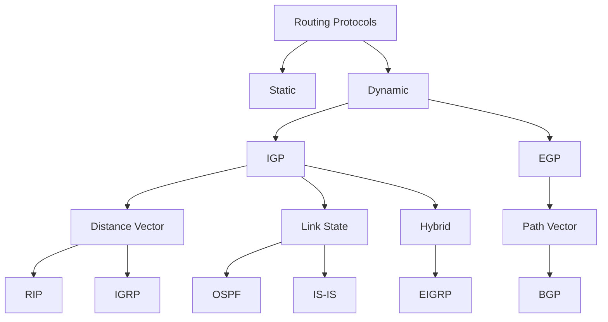
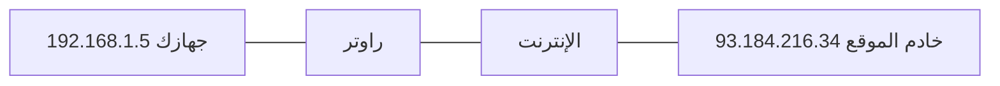
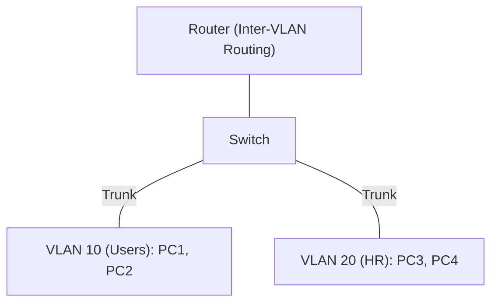
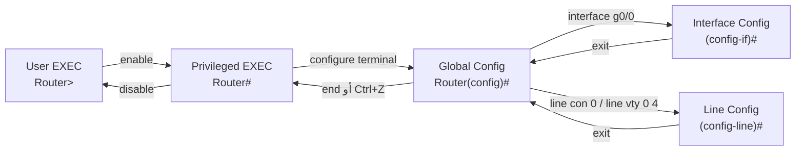
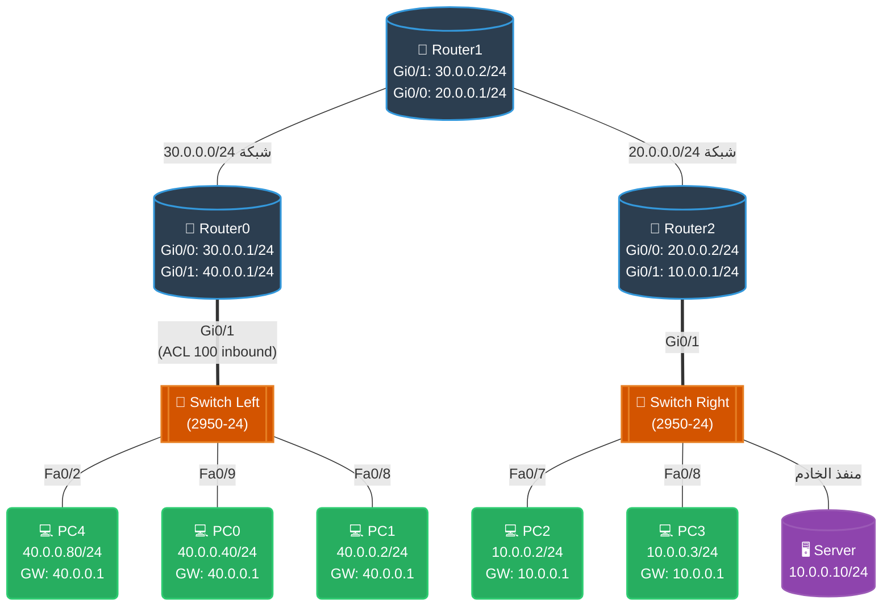
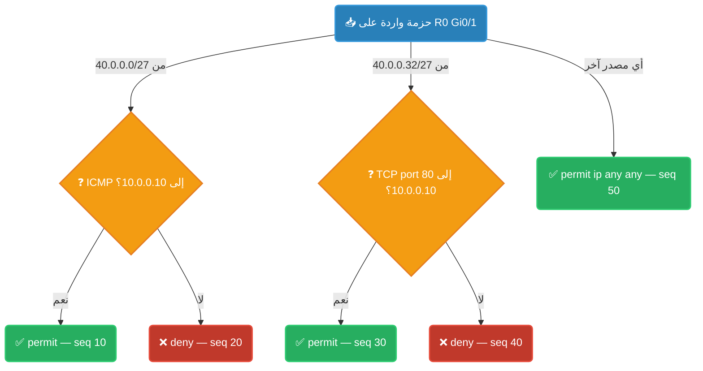

# CCNA Theory & Labs — النظري واللابات

> [!info] عن هذه الملاحظة
> دفتر موحّد يجمع ==المفاهيم والنظرية== (Part 1) مع ==الدرس التطبيقي ولاب ACLs الحقيقي== (Parts 2–3) بعد تنظيفه وتصحيحه وتوثيق أخطائه.
> مرجع الأوامر واستكشاف الأخطاء: [[CCNA Commands & Troubleshooting]] — نظرية STP: [[STP (Spanning Tree Protocol)]]

## الفهرس

**Part 1 — النظرية:**
- [[#1) تصنيف بروتوكولات التوجيه]]
- [[#2) IP Address — عنوان بروتوكول الإنترنت]]
- [[#3) VLANs — ملخص نظري]]
- [[#4) OSPF LSA Types]]

**Part 2 — الدرس الأول: أوامر Cisco IOS:**
- [[#5) أوضاع CLI (خرائط وجداول)]]
- [[#6) أساسيات أوامر IOS مشروحة]]
- [[#7) مثال كامل مرتّب (Config مصحّح)]]

**Part 3 — اللاب: Extended ACLs وحماية VTY:**
- [[#8) التوبولوجيا]]
- [[#9) المطلوب (مستنتج من الإعدادات)]]
- [[#10) Router0 — الـ Extended ACL (مفكوك الاختصارات ومصحّحًا)]]
- [[#11) Router2 — ACL مسمّاة + حماية VTY (مصحّحًا)]]
- [[#12) توصيات لتحسين Config اللاب]]
- [[#13) أخطاء اللوج وكيف تُصحّح]]
- [[#14) جدول فك الاختصارات المستخدمة في اللوج]]

**Part 4 — الموارد والروابط:**
- [[#15) روابط وموارد مفيدة]]
- [[#16) ملاحظات ذات صلة في المكتبة]]

---

## Part 1 — النظرية (Theory)

### 1) تصنيف بروتوكولات التوجيه
#ccna/theory #ccna/routing



> [!tip] ملاحظة على التصنيف الحديث
> في مناهج Cisco الحديثة يُوصف ==EIGRP== بأنه بروتوكول Distance Vector متقدم، بينما يضعه التصنيف الكلاسيكي (كما في المخطط) تحت ==Hybrid==.

> [!see-also] أوامر ذات صلة
> [[CCNA Commands & Troubleshooting#6) OSPF|OSPF]] • [[CCNA Commands & Troubleshooting#7) EIGRP|EIGRP]] • [[CCNA Commands & Troubleshooting#5) IPv4, Static Routing & RIPv2|RIP]] • [[CCNA Commands & Troubleshooting#BGP Troubleshooting|BGP]]

### 2) IP Address — عنوان بروتوكول الإنترنت
#ccna/theory #ccna/ip

#### 2.1 ما هو الـ IP Address؟

هو ==عنوان رقمي فريد== يُعطى لكل جهاز متصل بشبكة حاسوب أو بالإنترنت، ويُستخدم لتحديد هوية الجهاز وتمكينه من إرسال البيانات واستقبالها عبر الشبكة.

#### 2.2 استخدامات الـ IP Address

- تحديد هوية الأجهزة على الشبكة.
- إرسال واستقبال البيانات بين الأجهزة.
- الوصول إلى المواقع والخدمات على الإنترنت.
- تشغيل التطبيقات مثل الألعاب ومكالمات الفيديو.
- إدارة الشبكات والاتصالات بكفاءة.

#### 2.3 مكونات عنوان IPv4

- يتكون عنوان IPv4 من ==32 بت== (4 بايت).
- ويُكتب عادةً في شكل 4 أرقام عشرية مفصولة بنقاط.
- كل رقم يسمى ==Octet== ويتراوح من 0 إلى 255.

مثال: `192.168.1.10` → Octet 1 / Octet 2 / Octet 3 / Octet 4

> [!note] عدد العناوين في IPv4
> ≈ ==4.3 مليار== عنوان.

#### 2.4 أنواع IP حسب الإصدار

| الإصدار | الخصائص | مثال |
| --- | --- | --- |
| IPv4 | الأكثر استخدامًا؛ 32 بت؛ أربعة أرقام مفصولة بنقاط | 8.8.8.8 |
| IPv6 | الأحدث؛ 128 بت؛ أرقام وحروف سداسية عشرية | 2001:0db8:85a3::8a2e:0370:7334 |

> [!success] ميزة IPv6
> يوفر ==عددًا هائلًا جدًا== من العناوين.

#### 2.5 أنواع IP حسب الاستخدام

| النوع | الوصف |
| --- | --- |
| Public IP | يُستخدم على الإنترنت العالمي؛ يمنحه مزود خدمة الإنترنت (ISP)؛ يمكن الوصول إليه من أي مكان |
| Private IP | يُستخدم داخل الشبكات المحلية (LAN)؛ لا يمكن الوصول إليه من الإنترنت مباشرة |

نطاقات العناوين الخاصة:
- `10.0.0.0 – 10.255.255.255`
- `172.16.0.0 – 172.31.255.255`
- `192.168.0.0 – 192.168.255.255`

#### 2.6 ثابت ومتغير (Static / Dynamic IP)

**Static IP (ثابت):**
- لا يتغير مع الوقت.
- يُستخدم غالبًا للخوادم والمواقع والشركات.
- المميزات: ثابت ولا يتغير — مناسب للخدمات التي تحتاج اتصالًا دائمًَا.
- العيوب: أعلى تكلفة — يحتاج إعدادًا يدويًا أحيانًا.

**Dynamic IP (متغير):**
- يتغير بشكل تلقائي من قبل الراوتر أو مزود الخدمة.
- يُستخدم في معظم الأجهزة المنزلية.
- المميزات: سهل الإدارة — أكثر شيوعًا وأقل تكلفة.
- العيوب: قد يتغير عند إعادة تشغيل الراوتر أو بعد فترة معينة.

#### 2.7 كيف يعمل الـ IP Address؟

1. يرسل الجهاز طلبًا (مثلًا فتح موقع ويب).
2. يحتوي الطلب على الـ IP المرسل والـ IP الوجهة.
3. يتم تحويل اسم الموقع إلى IP باستخدام ==DNS==.
4. تنتقل البيانات عبر أجهزة الشبكة (==Routers==).
5. تصل البيانات إلى الجهاز الهدف.
6. يرسل الجهاز الهدف البيانات إلى جهازك.



#### 2.8 علاقة الـ IP بالـ DNS

الإنسان يتذكر أسماء المواقع مثل `google.com` لكن الأجهزة تتعامل مع ==أرقام IP==. يقوم ==DNS== (نظام أسماء النطاقات) بتحويل اسم الموقع إلى عنوان IP حتى يتم الاتصال بالعنوان الصحيح.

مثال: `google.com` → `142.250.72.78`

#### 2.9 هل يمكن معرفة موقع الشخص من الـ IP؟

يمكن معرفة معلومات تقريبية فقط: ==الدولة==، ==المدينة==، ==مزود خدمة الإنترنت==. لكن ==لا يمكن== معرفة العنوان المنزلي الدقيق في الظروف العادية.

#### 2.10 استخدامات الـ IP Address

- تصفح المواقع.
- الألعاب عبر الإنترنت.
- مكالمات الفيديو والصوت.
- إرسال البريد الإلكتروني.
- تشغيل الخوادم والمواقع.
- التواصل بين الأجهزة في الشبكات.

#### 2.11 مشاكل مرتبطة بالـ IP

- تعارض عنوانين IP داخل الشبكة.
- انقطاع الاتصال بسبب عدم الحصول على IP.
- حظر بعض المواقع بسبب عنوان IP.
- تغيير IP بشكل متكرر قد يسبب عدم استقرار الاتصال.
- أخطاء في إعداد الشبكة أو الراوتر.

#### 2.12 حماية عنوان الـ IP

- استخدام ==VPN== لإخفاء الـ IP الحقيقي.
- تفعيل جدار الحماية (==Firewall==).
- عدم مشاركة الـ IP الخاص بك على المواقع العامة.
- تحديث الأجهزة والبرامج باستمرار.
- تجنب الشبكات العامة غير الآمنة.

> [!quote] الخلاصة
> هو ==الهوية الرقمية== لأي جهاز على الشبكة، وبدونه لا يمكن للأجهزة التواصل مع بعضها أو الوصول إلى خدمات الإنترنت. فهمه ضروري لكل من يعمل في مجال الشبكات وتقنية المعلومات.

> [!see-also] أوامر ذات صلة
> [[CCNA Commands & Troubleshooting#5) IPv4, Static Routing & RIPv2|IPv4]] • [[CCNA Commands & Troubleshooting#8) IPv6|IPv6]]

### 3) VLANs — ملخص نظري
#ccna/theory #ccna/vlans

#### ما هي الـ VLANs؟

==Virtual Local Area Network==: هي شبكة محلية افتراضية — تقسيم منطقي للسويتش الواحد إلى ==عدة شبكات منفصلة==، حتى لو كانت الأجهزة متصلة بنفس السويتش.

> [!abstract] الفكرة الأساسية
> - الأجهزة داخل نفس الـ VLAN تتواصل ==مباشرة==.
> - الأجهزة في VLAN مختلفة تحتاج إلى ==Router== أو ==Layer 3 Switch== للتواصل.

#### لماذا نستخدم VLANs؟

- زيادة ==الأمان== (عزل الأقسام عن بعض).
- تقليل الـ ==Broadcast== (يحسّن أداء الشبكة).
- ==تنظيم== الشبكة (كل قسم له شبكة خاصة).
- ==سهولة الإدارة== (نقل موظف لقسم آخر دون تغيير الكابلات).

#### مثال بسيط

| الجهاز | VLAN |
| --- | --- |
| PC1 | 10 |
| PC2 | 10 |
| PC3 | 20 |
| PC4 | 20 |

- PC1 يقدر يكلم PC2 مباشرة، وPC3 يقدر يكلم PC4 مباشرة.
- PC1 ==لا== يقدر يكلم PC3 إلا عن طريق ==Router==.

#### شرح مبسط للـ Tagging

- عندما تمر البيانات داخل ==Trunk==، يقوم السويتش بإضافة ==Tag== يحدد رقم الـ VLAN.
- السويتش الآخر يقرأ الـ ==Tag== ويوجه البيانات إلى الـ VLAN الصحيحة.

#### أنواع المنافذ مع VLAN

| Access Port | Trunk Port |
| --- | --- |
| يُستخدم لتوصيل جهاز واحد مثل: PC، Printer، IP Phone | يُستخدم بين: Switch ↔ Switch وSwitch ↔ Router |
| المنفذ ينتمي إلى VLAN ==واحدة فقط== | ينقل ==أكثر من== VLAN في الوقت نفسه باستخدام ==802.1Q== Tagging |

> [!note] Native VLAN
> هي الـ VLAN التي تمر ==بدون Tag== داخل الـ Trunk (افتراضيًا: ==VLAN 1==). ويُفضل تغييرها لأسباب أمنية.

#### أشهر أرقام VLANs

| VLAN | الاستخدام |
| --- | --- |
| 1 | (Default) الافتراضية |
| 10 | Users |
| 20 | HR |
| 30 | IT |
| 99 | Management |

#### كيف تتواصل VLANs مع بعضها؟

عن طريق ==Router-on-a-Stick== أو ==Layer 3 Switch== — ويسمى هذا ==Inter-VLAN Routing==.



#### مثال واقعي

شركة لديها: الموظفون = VLAN 10، الكاميرات = VLAN 20، السيرفرات = VLAN 30. لو تعرض جهاز موظف للاختراق، فلن يصل المهاجم إلى الكاميرات أو السيرفرات بسهولة ==بسبب العزل بين VLANs==.

> [!success] أهم النقاط لفهم VLANs بسرعة
> - [x] VLAN = تقسيم ==منطقي== للشركة.
> - [x] كل VLAN تعتبر شبكة ==مستقلة==.
> - [x] Access Port يحمل VLAN ==واحدة==.
> - [x] Trunk Port يحمل ==أكثر من== VLAN في نفس الوقت.
> - [x] التواصل بين VLANs يحتاج إلى ==Routing==.

> [!see-also] الأوامر (لم تُكرر هنا لأنها موجودة في ملف الأوامر)
> [[CCNA Commands & Troubleshooting#3) VLANs, Trunks & VTP|أوامر VLANs & Trunks]] • [[CCNA Commands & Troubleshooting#VLAN & Trunking|استكشاف أخطاء VLAN]]

### 4) OSPF LSA Types
#ccna/theory #ccna/ospf

> [!info] القاعدة العامة
> كل نوع من الـ ==LSA== يحمل معلومات مختلفة ويُستخدم في حالة معينة.

#### ما هو LSA؟

==LSA (Link-State Advertisement)==: هو رسالة يرسلها الراوتر داخل منطقة OSPF لنشر معلومات ==الحالة الرابطية (Link State)== إلى باقي الراوترات.

تنتشر رسائل LSA بين الراوترات داخل نفس المنطقة ومع المناطق الأخرى حسب نوع الـ LSA.

#### أهميته

- يبني جدول التوجيه (==Routing Table==).
- يساعد على التعرف على الشبكات المتاحة.
- يُستخدم في التحديثات عند حدوث تغييرات في الشبكة.

لهذا السبب، فهم أنواعه ضروري للتعامل مع مشاكل OSPF.

#### أنواع رسائل LSA

| النوع | الاسم | المرسل | الاستخدام |
| --- | --- | --- | --- |
| Type 1 | Router LSA | كل راوتر داخل المنطقة | يعلن عن نفسه، وواجهاته، والمسارات المتصلة |
| Type 2 | Network LSA | الـ ==DR== فقط (في الشبكات متعددة الوصول) | يعلن عن جميع الراوترات المتصلة بهذه الشبكة |
| Type 3 | Summary LSA | الـ ==ABR== (بين المناطق) | يعلن عن شبكات مناطق أخرى داخل المنطقة |
| Type 4 | ASBR Summary LSA | الـ ==ABR== (بين المناطق) | يعلن عن وجود ==ASBR== داخل المنطقة |
| Type 5 | External LSA | الـ ==ASBR== (من خارج OSPF) | يعلن عن المسارات الخارجية من مصادر غير OSPF |
| Type 7 | NSSA LSA | الـ ==ASBR== (في منطقة NSSA) | يعلن عن المسارات الخارجية داخل منطقة NSSA |

> [!tip] ملاحظات مهمة
> - Type ==1 و2== يُستخدمان داخل نفس المنطقة.
> - Type ==3== يفعّع حدود المناطق من خلال الـ ==ABR==.
> - Type ==4 و5== يُستخدمان للتعامل مع الـ ==ASBR== والمسارات الخارجية.
> - Type ==7== يُستخدم فقط في منطقة ==NSSA== ويُحول إلى ==Type 5== عند الخروج من المنطقة.

> [!abstract] تذكر
> كل نوع له دور محدد في بناء ==صورة كاملة== للشبكة داخل OSPF.

#### أوامر مهمة

```text
R1# show ip ospf database            (لعرض جميع أنواع الـ LSA في قاعدة البيانات)
R1# show ip ospf database summary   (لعرض ملخص المسارات Type 3, 4, 5)
```

> [!see-also] ذات صلة
> [[CCNA Commands & Troubleshooting#6) OSPF|مرجع OSPF]] • [[CCNA Commands & Troubleshooting#OSPF Troubleshooting|OSPF Troubleshooting]]

---

## Part 2 — الدرس الأول: أوامر Cisco IOS

> [!note] درس تعليمي وليس مرجعًا
> هذا الجزء هو تسلسل الدرس كما نُفّذ خطوة بخطوة (مع أخطائه الموثقة في callouts). للمرجع السريع الموحّد: [[CCNA Commands & Troubleshooting#1) Basic CLI & Device Management]]

### 5) أوضاع CLI (خرائط وجداول)



| الـ Prompt | الوضع | ماذا تفعل فيه؟ |
| --- | --- | --- |
| Router> | User EXEC | أوامر عرض محدودة فقط |
| Router# | Privileged EXEC | أوامر `show` و`debug` والحفظ و`reload` |
| Router(config)# | Global Config | إعدادات الجهاز العامة |
| Router(config-if)# | Interface Config | إعدادات واجهة معيّنة |
| Router(config-line)# | Line Config | إعدادات console / aux / vty |

> [!tip] قاعدة الـ `do`
> أوامر الـ EXEC (مثل `show` و`reload`) لا تعمل داخل أوضاع الـ config مباشرة؛ استخدم بادئة `do`:
> `ahmed(config-if)# do show ip interface brief`

### 6) أساسيات أوامر IOS مشروحة

#### 6.1 الدخول إلى وضع الإعداد وتغيير الاسم

```text
Router> enable
Router# configure terminal
Router(config)# hostname ahmed
```

- `enable`: ينقلك من User EXEC (`>`) إلى Privileged EXEC (`#`).
- `configure terminal`: يدخلك Global Configuration Mode لبدء تعديل الإعدادات.
- `hostname ahmed`: يغيّر اسم الجهاز، فيتغير الـ prompt إلى `ahmed(config)#`.

#### 6.2 الواجهات وعناوين IP

```text
ahmed(config)# interface gigabitEthernet 0/0/0
ahmed(config-if)# ip address 10.0.0.2 255.255.255.0
ahmed(config-if)# no shutdown
ahmed(config-if)# do show ip interface brief
```

- `interface ...`: يدخل Interface Configuration Mode لواجهة محددة.
- `ip address ...`: يضبط العنوان والـ subnet mask على الواجهة.
- `no shutdown`: يفعّل الواجهة إداريًا (كثير منها افتراضيًا `administratively down`).
- بعد التشغيل قد ترى `changed state to up` = الواجهة والـ line protocol يعملان (إذا كان الطرف الآخر سليمًا).

> [!bug] خطأ وارد في اللوج
> كتبت `show ip iner` — الصيغة الصحيحة: `show ip interface brief`.

#### 6.3 الحفظ وإعادة التشغيل

```text
ahmed# copy running-config startup-config
! أو الاختصارات:
ahmed# write memory
ahmed# wr
ahmed# reload
```

- `copy running-config startup-config`: يحفظ الإعدادات الحالية لتبقى بعد إعادة التشغيل.
- `wr` / `write memory`: اختصار قديم بنفس الوظيفة.
- `reload`: يعيد التشغيل؛ إن كانت هناك تغييرات غير محفوظة سيسألك أولًا.

> [!bug] خطأ شائع
> `reload` أمر EXEC وليس Configuration — لا تكتبه داخل `(config)#` مباشرة؛ استخدم `do reload` أو اخرج أولًا بـ `end`.

#### 6.4 كلمات السر والتشفير

```text
ahmed(config)# enable secret ahmed        ! الطريقة الأفضل (مشفرة)
ahmed(config)# enable password 1234       ! الطريقة القديمة (أضعف)
ahmed(config)# no enable password         ! حذف enable password
ahmed(config)# line console 0
ahmed(config-line)# password 1234
ahmed(config-line)# login                 ! بدونه لن تُطلب كلمة السر إطلاقًا
ahmed(config-line)# exit
ahmed(config)# line aux 0
ahmed(config-line)# password 1234
ahmed(config-line)# login
ahmed(config-line)# exit
ahmed(config)# service password-encryption
```

- `enable secret` يتفوق على `enable password` إذا وُجدا معًا.
- `login` ضروري لتفعيل طلب كلمة السر على الخط؛ بدونه تبقى الحماية معطلة.
- `service password-encryption`: يخفي كلمات السر النصية (console/aux/enable password) من `show running-config` — لا يغيّر قيمتها.

> [!bug] أخطاء واردة في اللوج
> - `no enable password 1234` ❌ — الصحيح: `no enable password` (بدون قيمة).
> - كلمة سر console بدون `login` ❌ — أضف `login` دائمًا.

#### 6.5 عرض الإعدادات

```text
ahmed# show running-config          ! الإعدادات العاملة الآن في RAM
ahmed(config)# do show running-config   ! نفس الأمر من داخل وضع الإعداد
```

### 7) مثال كامل مرتّب (Config مصحّح)

```text
Router> enable
Router# configure terminal
Router(config)# hostname ahmed
Router(config)# interface gigabitEthernet 0/0/0
Router(config-if)# ip address 10.0.0.2 255.255.255.0
Router(config-if)# no shutdown
Router(config-if)# do show ip interface brief
Router(config-if)# exit
Router(config)# enable secret ahmed
Router(config)# line console 0
Router(config-line)# password 1234
Router(config-line)# login
Router(config-line)# exit
Router(config)# line aux 0
Router(config-line)# password 1234
Router(config-line)# login
Router(config-line)# exit
Router(config)# service password-encryption
Router(config)# end
Router# copy running-config startup-config
```

التسلسل: تغيير الاسم → ضبط IP وتشغيل الواجهة → حماية الجهاز → الحفظ.

---

## Part 3 — اللاب: Extended ACLs وحماية VTY

### 8) التوبولوجيا



| الجهاز | الواجهة/الدور | العنوان |
| --- | --- | --- |
| PC1 / PC0 / PC4 | أجهزة الطرف الأيسر (GW 40.0.0.1) | 40.0.0.2 / 40.0.0.40 / 40.0.0.80 |
| Router0 | G0/1 ← جهة المستخدمين | 40.0.0.1/24 |
| Router0 | G0/0 ← WAN | 30.0.0.1/24 |
| Router1 | G0/1 / G0/0 | 30.0.0.2/24 / 20.0.0.1/24 |
| Router2 | G0/0 / G0/1 | 20.0.0.2/24 / 10.0.0.1/24 |
| PC2 / PC3 | أجهزة الطرف الأيمن (GW 10.0.0.1) | 10.0.0.2 / 10.0.0.3 |

> [!note] التوجيه في اللاب
> ظهور مسارات `R` في `show ip route` لدى Router2 يعني أن ==RIP== كان يعمل على الراوترات (غير موثق في اللوج):
> ```text
> RouterX(config)# router rip
> RouterX(config-router)# version 2
> RouterX(config-router)# no auto-summary
> ```

### 9) المطلوب (مستنتج من الإعدادات)

1. السماح لـ ==ICMP== فقط من `40.0.0.0/27` إلى الخادم `10.0.0.10` وحجب باقي traffic تلك الشبكة.
2. السماح لـ ==TCP/80== فقط من `40.0.0.32/27` إلى نفس الخادم وحجب باقي traffic تلك الشبكة.
3. حماية دخول Telnet إلى Router2 بحيث يُسمح فقط للمضيف `40.0.0.2`.
4. ACL مسمّاة (standard) باسم `asd` للتجربة مع تحرير بأرقام التسلسل.

### 10) Router0 — الـ Extended ACL (مفكوك الاختصارات ومصحّحًا)

```text
Router0(config)# access-list 100 permit icmp 40.0.0.0 0.0.0.31 host 10.0.0.10
Router0(config)# access-list 100 deny ip 40.0.0.0 0.0.0.31 any
Router0(config)# access-list 100 permit tcp 40.0.0.32 0.0.0.31 host 10.0.0.10 eq 80
Router0(config)# access-list 100 deny ip 40.0.0.32 0.0.0.31 any
Router0(config)# access-list 100 permit ip any any
Router0(config)# interface g0/1
Router0(config-if)# ip access-group 100 in
```

(في اللوج كُتبت مختصرة: `acc 100 per ...` و`ip acc 100 in`.)

منطق القرار داخل الـ ACL:



> [!tip] لماذا هذا الترتيب صحيح؟
> الـ ACL تُعالج بمنطق ==first-match==: قواعد الاستثناء المحددة أولًا، ثم قاعدة السماح العامة آخرًا (وإلا لحجبت كل شيء).

### 11) Router2 — ACL مسمّاة + حماية VTY (مصحّحًا)

```text
Router2(config)# ip access-list standard asd
Router2(config-std-nacl)# permit host 1.1.1.1
Router2(config-std-nacl)# permit host 2.1.1.1
Router2(config-std-nacl)# deny host 3.3.3.3
Router2(config-std-nacl)# 15 permit host 6.6.6.6      ! إدراج برقم تسلسل بين 10 و20
Router2(config-std-nacl)# exit
Router2(config)# enable password asd
Router2(config)# access-list 1 permit host 40.0.0.2
Router2(config)# line vty 0 4
Router2(config-line)# access-class 1 in               ! الصحيح: access-class وليس acc
Router2(config-line)# transport input telnet
Router2(config-line)# password asd
Router2(config-line)# login
```

> [!example]- ناتج `show access-lists` بعد الإدراج برقم 15
> ```text
> Standard IP access list asd
>     10 permit host 1.1.1.1
>     15 permit host 6.6.6.6
>     20 permit host 2.1.1.1
>     30 deny host 3.3.3.3
> Standard IP access list 1
>     10 permit host 40.0.0.2
> ```

> [!example]- ناتج `show ip route` لدى Router2 (يدل على عمل RIP)
> ```text
> R 30.0.0.0/24 [120/1] via 20.0.0.1, GigabitEthernet0/0
> R 40.0.0.0/24 [120/2] via 20.0.0.1, GigabitEthernet0/0
> C 10.0.0.0/24 is directly connected, GigabitEthernet0/1
> C 20.0.0.0/24 is directly connected, GigabitEthernet0/0
> ```

### 12) توصيات لتحسين Config اللاب

> [!warning] تحسينات أمنية مقترحة
> - استبدل `enable password asd` بـ ==`enable secret`==.
> - أضف ==`no ip domain-lookup`== لتعليق محاولة ترجمة الأوامر الخاطئة إلى أسماء (ما حدث مع `login` في وضع `#`).
> - فضّل ==`transport input ssh`== على telnet بعد تجهيز SSH (`crypto key generate rsa` + `login local`).
> - طبّق نفس فكرة `access-class` على مستوى الإدارة الحديثة: VTY + ACL + timeout.

### 13) أخطاء اللوج وكيف تُصحّح

| كما ورد في اللوج | المشكلة | الصيغة الصحيحة |
| --- | --- | --- |
| show ip iner | خطأ إملائي | show ip interface brief |
| no enable password 1234 | لا تُحذف مع القيمة | no enable password |
| password للـ console بدون `login` | الحماية لا تُفعّل | أضف `login` |
| `reload` داخل `(config)#` | أمر EXEC | `do reload` أو `end` أولًا |
| `acc 1 in` في وضع line | Ambiguous command | access-class 1 in |
| `access-list 1 permit host 40.0.0.2` عند `Router2#` | أمر config في وضع EXEC | `configure terminal` أولًا |
| `login` عند `Router2#` | عومل كاسم مضيف → DNS lookup | وضع line + `no ip domain-lookup` احتياطًا |
| `(config-line)#conf t` | غير صالح في وضع line | `exit` ثم `configure terminal` |

### 14) جدول فك الاختصارات المستخدمة في اللوج

| الاختصار | الأمر الكامل |
| --- | --- |
| acc 100 per ... | access-list 100 permit ... |
| `ip acc 100 in` (على واجهة) | ip access-group 100 in |
| ip acc standard asd | ip access-list standard asd |
| per / deny | permit / deny |
| ena pass asd | enable password asd |
| int g0/1 | interface g0/1 |
| sh acc | show access-lists |
| conf t | configure terminal |
| wr | write memory |

---

## Part 4 — الموارد والروابط

### 15) روابط وموارد مفيدة

**أتمتة الشبكات وPython:**
- [Network Automation Using Python](https://github.com/glitchawy/Network-Automation-Using-Python/)
- [Cisco Automation with Python Scripts](https://github.com/MohameElhady/Cisco-Automation-with-Python-Scripts)
- [NetScan Pro — ماسح شبكات](https://github.com/niladri-1/NetScan-Pro)

**صور الأجهزة واللابات:**
- [صور EVE-NG جاهزة](https://github.com/gala2024/images_eve-ng)
- [صور Cisco لـ GNS3 وEVE-NG](https://github.com/hegdepavankumar/Cisco-Images-for-GNS3-and-EVE-NG)
- [NetAcad — تحميل اللابات الرسمية](https://www.netacad.com/resources/lab-downloads?courseLang=en-US)
- [مكتبة LabHub](https://drive.labhub.eu.org/0:/)

**أرشيفات خارجية (صور ISO/IOU):**
- [d.idc.ir](https://d.idc.ir/)
- [مجلد Mega.nz](https://mega.nz/folder/r7x13Q7I#1GAeUh89T3oFhSF1wyCquQ/folder/73ASVSra)

> [!warning] تنبيه قانوني/أمني
> حمّل صور IOS من مصادر رسمية (NetAcad/Cisco) قدر الإمكان؛ الصور غير الرسمية قد تكون معدّلة أو مخالفة للترخيص.

### 16) ملاحظات ذات صلة في المكتبة

- [[CCNA Commands & Troubleshooting#1) Basic CLI & Device Management|أساسيات CLI وحماية الجهاز]]
- [[CCNA Commands & Troubleshooting#9) ACLs — Complete Reference|مرجع ACLs الكامل (Standard/Extended/Named)]]
- [[CCNA Commands & Troubleshooting#ACL & NAT Troubleshooting|استكشاف أخطاء ACL/NAT]]
- [[#1) تصنيف بروتوكولات التوجيه|لماذا تظهر مسارات RIP بالحرف R؟]]
- [[STP (Spanning Tree Protocol)]]