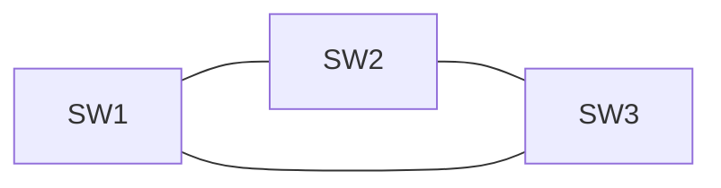
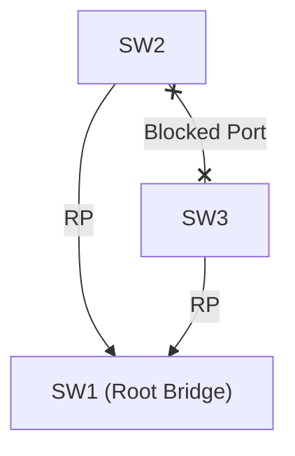
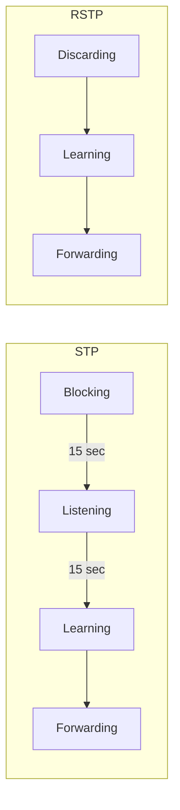
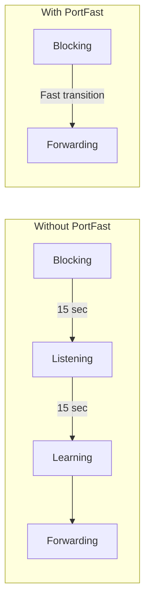
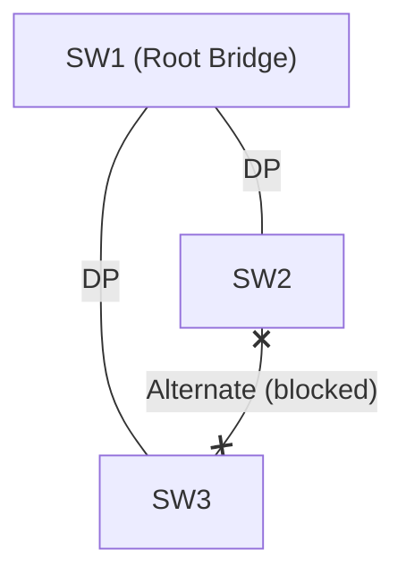
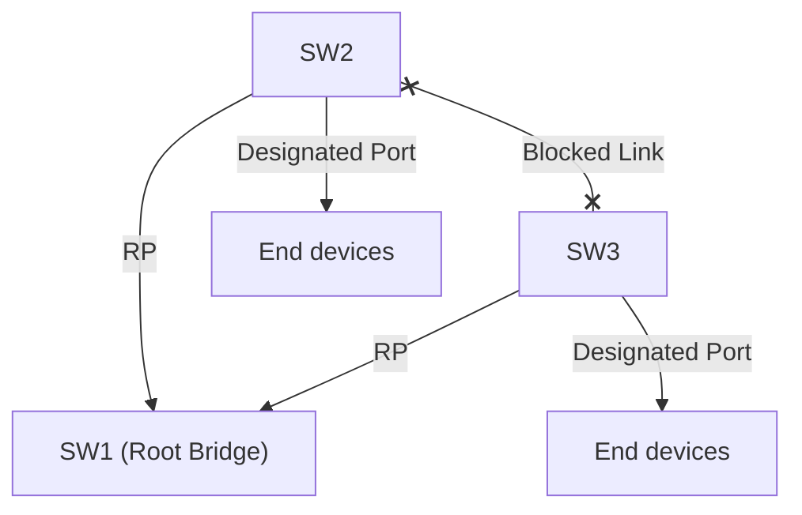

# STP (Spanning Tree Protocol)

> [!info] عن هذه الملاحظة
> ملاحظات نظرية ومراجعات لبروتوكول STP من 5 لوحات (Page 1–5).
> للأوامر العملية راجع: [[CCNA Commands & Troubleshooting#STP & EtherChannel |STP & EtherChannel — ملف الأوامر]].
## الفهرس
- [[#Page 1 — Basics & Why STP]]
- [[#Page 2 — Layer 2, Bridge Election, Port Roles & States]]
- [[#Page 3 — RSTP, Timers, Path Cost & Protection]]
- [[#Page 4 — Alternate/Backup Ports, Topology Changes, PVST+ & Lab]]
- [[#Page 5 — Convergence, BPDU Types, States Detail & Show Commands]]

---

## Page 1 — Basics & Why STP
#ccna/stp

### Definition
STP (Spanning Tree Protocol) is a ==Layer 2== protocol that prevents ==switching loops== in a redundant network. It ensures that only ==one active path== exists between any two devices by ==blocking== redundant links.

> [!success] Key Points
> - [x] Prevents ==loops==
> - [x] Provides ==redundancy==
> - [x] Ensures ==stability==
> - [x] Runs on ==Layer 2==

### Why STP is Needed?
In a switched network, if there are multiple paths between switches, ==loops== can occur. This causes serious problems like:
1. Switching Loops
2. Broadcast Storm
3. MAC Address Table Instability
4. Multiple Frame Copies
5. High CPU Utilization

### 1. Switching Loops
When redundant links exist, frames keep ==circulating== in the network.



> [!warning] Frames keep ==looping== forever between SW1, SW2 and SW3.

### 2. Broadcast Storm
Broadcast frames are flooded on all ports and keep ==multiplying==. A huge number of broadcast frames ==congests== the network.

### Basic STP Operation
1. STP selects a ==Root Bridge==.
2. It selects ==Root Ports== on all other switches.
3. It selects ==Designated Ports== on each segment.
4. It ==blocks== redundant ports (Non-designated ports) to prevent loops.
5. The network becomes a ==Loop-free== topology (==Spanning Tree==).

> [!quote]
> STP allows ==redundancy== but keeps the network ==loop-free== and ==stable==.

---

## Page 2 — Layer 2, Bridge Election, Port Roles & States
#ccna/stp

### 3. STP Works on Layer 2
- STP is a ==Data Link Layer== (Layer 2) protocol.
- It uses special ==Bridge ID (BID)== to elect ==Root Bridge==.
- It uses ==BPDU== (Bridge Protocol Data Unit) to ==exchange== information.

> [!note] BPDU Information
> - Root Bridge ID
> - Root Path Cost
> - Sender Bridge ID
> - Port ID
> - Message Age
> - Max Age, Hello Time, Forward Delay

### 4. Root Bridge Election
- All switches send ==BPDU== to each other.
- The switch with the ==lowest Bridge ID== becomes the ==Root Bridge==.
- ==Bridge ID== = ==Priority== + ==MAC Address==

| Switch | Priority | MAC Address | Bridge ID |
| --- | --- | --- | --- |
| SW1 | 32768 | 0000.1111.1111 | 32768.0000.1111.1111 |
| SW2 | 32768 | 0000.2222.2222 | 32768.0000.2222.2222 |
| SW3 | 32768 | 0000.3333.3333 | 32768.0000.3333.3333 |

→ ==SW1== has ==lowest Bridge ID==, so ==SW1== is ==Root Bridge==.

### 5. Port Roles in STP
- ==Root Port (RP)==: Best path from non-root switch to Root Bridge.
- ==Designated Port (DP)==: Best port on each segment.
- ==Non-designated Port (Blocked Port)==: Redundant port, kept in blocking state to prevent loops.



- SW1 is Root Bridge.
- All ports of Root Bridge are ==Designated Ports==.
- SW2 and SW3 choose their ==Root Port== (best path to Root).
- One port on the SW2–SW3 link will be ==blocked==.

### 6. STP Port States
1. ==Blocking==: Discards all frames.
2. ==Listening==: 15 seconds.
3. ==Learning==: 15 seconds.
4. ==Forwarding==: Forwards frames normally.


> [!info] Total time to move from ==Blocking== to ==Forwarding== = ==~30 sec==

> [!quote]
> STP ensures a ==loop-free==, ==redundant== and ==stable== network by intelligently blocking redundant paths.

---

## Page 3 — RSTP, Timers, Path Cost & Protection
#ccna/stp #ccna/rstp

### 7. RSTP (Rapid STP)
- RSTP is the improved version of STP (IEEE ==802.1w==).
- It provides ==faster convergence==.
- RSTP uses ==discarding== and ==learning== states instead of ==listening== and ==learning==.
- It allows point-to-point links to move directly to ==forwarding== state.


(No Listening state in RSTP)

### 8. STP Timers

| Timer | Default | Description |
| --- | --- | --- |
| Hello Time | 2 sec | Time between two BPDUs sent by the Root Bridge. |
| Max Age | 20 sec | If a switch does not receive BPDU within this time, it recalculates the topology. |
| Forward Delay | 15 sec | Time spent in Listening and Learning state each. |

> [!warning] قاعدة مهمة
> ==Max Age== must be greater than (2 × ==Forward Delay==).

### 9. Path Cost Calculation
- STP selects the path to Root Bridge based on the ==lowest path cost==.
- Each link speed has a default cost.

| Link Speed | Default Cost |
| --- | --- |
| 10 Mbps | 100 |
| 100 Mbps | 19 |
| 1 Gbps | 4 |
| 10 Gbps | 2 |

> [!tip] ==Lower cost== path is preferred.

### 10. PortFast
- PortFast puts an ==edge port== directly into ==forwarding== state.
- It is used on ==access ports== (connected to end devices).



### 11. BPDU Guard
- Enables on ==PortFast ports==.
- If BPDU is received on that port, it puts the port in ==error-disable== state.
- Protects the network from loops caused by ==unauthorized switches==.

### 12. Root Guard
- Enables on a ==non-root switch port== to prevent it from becoming root.
- If ==superior BPDU== is received, the port goes to ==root-inconsistent== state.
- Protects the ==root bridge==.

### 13. Loop Guard
- Enables on ==non-designated ports==.
- If BPDU is not received before ==Max Age==, the port goes to ==loop-inconsistent== state.
- Protects against ==unidirectional link failures==.

### 14. STP Troubleshooting Commands (Cisco)

| Command | Purpose |
| --- | --- |
| `show spanning-tree` | Shows overall STP information. |
| `show spanning-tree vlan <vlan-id>` | Shows STP details for a specific VLAN. |
| `show spanning-tree detail` | Shows detailed STP information. |
| `show spanning-tree interface <int> detail` | Shows STP information of a specific interface. |
| `debug spanning-tree events` | Troubleshoots STP by showing events. |

> [!success] Key Things to Verify
> - [x] Root Bridge
> - [x] Root Port
> - [x] Designated Port
> - [x] Blocked/Alternate Port
> - [x] BPDU Timers
> - [x] Port States

> [!quote]
> STP prevents loops and ensures a ==stable==, ==redundant== and ==efficient== network.

---

## Page 4 — Alternate/Backup Ports, Topology Changes, PVST+ & Lab
#ccna/stp

### 15. Alternate & Backup Ports
- ==Alternate Port (Blocking Port)==: A port that has a better path to the Root Bridge than the designated port of that segment.
- ==Backup Port==: A port that provides an alternate path to the Root Bridge.

> [!note] Only ==one Designated Port== per segment.

### 16. STP Topology Changes
- When a ==link fails==, STP reconverges and blocks/unblocks ports to maintain ==loop-free topology==.
- Before failure: SW2–SW3 link is ==Blocking (Alternate)== → after failure it becomes ==Forwarding (New DP)==.

### 17. Multiple VLAN STP (PVST+, MSTP)
- ==PVST+==: One STP instance per VLAN.
- ==MSTP==: Maps multiple VLANs to a single STP instance for scalability.

| Mode | Mapping |
| --- | --- |
| PVST+ | VLAN 10 → STP instance, VLAN 20 → STP instance, VLAN 30 → STP instance |
| MSTP | Instance 1 (VLAN 10,20), Instance 2 (VLAN 30,40) |

### 18. BPDU Filter
- Configures a port to ==neither send nor receive== BPDUs.
- The port behaves like a ==normal Layer 2 port==.

> [!danger] استخدمه بحذر
> Use with care — ==may cause loops==.

### 19. STP States Summary

| State | Role | Receives BPDUs | Sends BPDUs | Forwards Frames |
| --- | --- | --- | --- | --- |
| Blocking | Blocks loops | Yes | Yes | No |
| Listening | Learns MAC | Yes | Yes | No |
| Learning | Learns MAC | Yes | Yes | No |
| Forwarding | Forwards traffic | Yes | Yes | Yes |

### 20. STP Port Priority
- ==Lower== port priority value = ==Higher== priority.
- Range: ==0 - 240== (in steps of ==16==).
- Default: ==128==.
- Example: SW1 port (Priority 16) wins over SW2 port (Priority 128) and becomes the ==Designated Port==.

### 21. Practical STP Lab Topology



Verify using commands:
```
show spanning-tree
show spanning-tree vlan <id>
show spanning-tree detail
show spanning-tree interface <int>
debug spanning-tree events
```

> [!success] Remember
> - [x] Root Bridge
> - [x] Root Port
> - [x] Designated Port
> - [x] Blocked (Alternate) Port
> - [x] Port States
> - [x] BPDU Timers
> - [x] Protection Features

> [!quote]
> STP = ==Stability== + ==Redundancy== + ==Loop Prevention==

---

## Page 5 — Convergence, BPDU Types, States Detail & Show Commands
#ccna/stp

### 22. STP Convergence
- ==Convergence time== is the time taken by STP to transition the network to a ==stable== state.
- RSTP converges much ==faster== than STP.
- Convergence depends on ==timers== and ==topology==.

> [!info] Typical Convergence Time
> - STP (802.1d): ==30 - 50 seconds==
> - RSTP (802.1w): ==1 - 2 seconds==

### 23. STP BPDU Types
STP uses BPDUs to exchange information. There are ==3 types== of BPDUs.

| BPDU Type | Description | Used For |
| --- | --- | --- |
| Configuration BPDU | Sent by Root Bridge to advertise topology info. | Normal operation |
| TCN BPDU | Topology Change Notification. | Notifies other switches about topology change. |
| TCA BPDU | Topology Change Acknowledgement. | Acknowledges receipt of TCN BPDU. |

> [!note] BPDUs are sent to the multicast address ==01-80-C2-00-00-00==

### 24. STP Port States (Detailed)

| State | Description | Can Send BPDUs | Can Receive BPDUs | Forwards Frames |
| --- | --- | --- | --- | --- |
| Blocking | Port does not forward traffic. | No | Yes | No |
| Listening | Port listens for BPDUs to learn. | Yes | Yes | No |
| Learning | Port learns MAC addresses. | Yes | Yes | No |
| Forwarding | Port forwards user traffic. | Yes | Yes | Yes |

### 25. UplinkFast & BackboneFast (Legacy)
- ==Legacy Cisco== features (proprietary).
- Used with STP to speed up convergence.
- ==Replaced by RSTP==.

| Feature | Function |
| --- | --- |
| UplinkFast | Quickly transitions a port to forwarding state when it connects to a device. |
| BackboneFast | Quickly transitions a port to forwarding state when it connects to the backbone (another switch). |

### 26. Common STP Features (Protection)
1. ==PortFast==: Enables edge ports to move directly to forwarding state.
2. ==BPDU Guard==: Shuts down port if BPDU is received.
3. ==Root Guard==: Prevents port from becoming Root Port.
4. ==Loop Guard==: Prevents loops due to unidirectional link failures.
5. ==BPDU Filter==: Stops sending and receiving BPDUs on a port.

Quick Reference:

| Feature | Applied On |
| --- | --- |
| PortFast | Access ports |
| BPDU Guard | Access ports |
| Root Guard | Uplink ports |
| Loop Guard | Uplink ports |
| BPDU Filter | Special links |

### 27. Show Commands (Cisco)

| Command | Purpose |
| --- | --- |
| `show spanning-tree` | Summary of STP status |
| `show spanning-tree vlan <vlan-id>` | STP for a specific VLAN |
| `show spanning-tree detail` | Detailed STP information |
| `show spanning-tree interface <int> detail` | STP info on an interface |
| `show spanning-tree summary` | Brief summary (Cisco) |
| `show spanning-tree inconsistentports` | Shows inconsistent ports |
| `debug spanning-tree events` | Troubleshoot STP events |

> [!abstract] Key Takeaways
> - [x] STP prevents ==loops== and ensures a loop-free topology.
> - [x] ==Root Bridge== is the heart of the STP topology.
> - [x] Only one ==active path== exists between any two switches.
> - [x] RSTP provides ==fast== convergence.
> - [x] Use ==protection features== on edge ports to avoid loops.



---

## Related
- [[CCNA Command Cheat Sheet#STP & EtherChannel (p. 4/10)|STP & EtherChannel — أوامر]]
- [[CCNA Command Cheat Sheet#VLANs & Trunks (p. 3/10)|VLANs & Trunks — أوامر]]